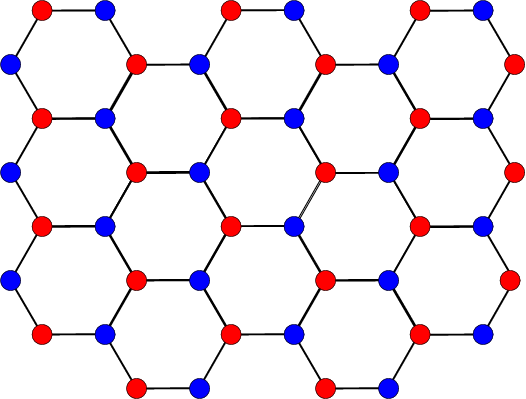
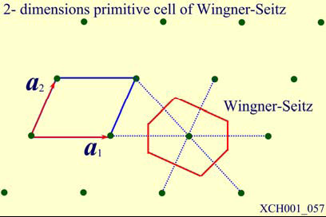
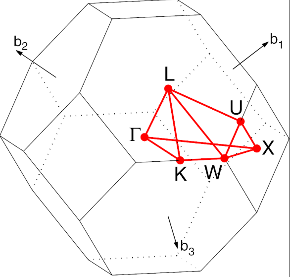
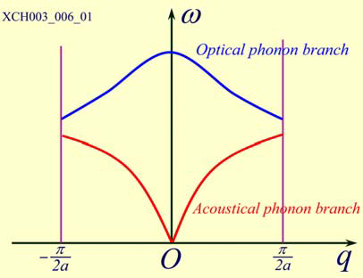
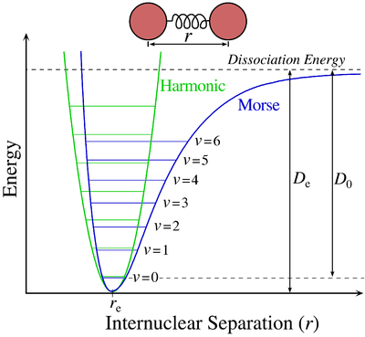
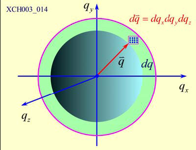
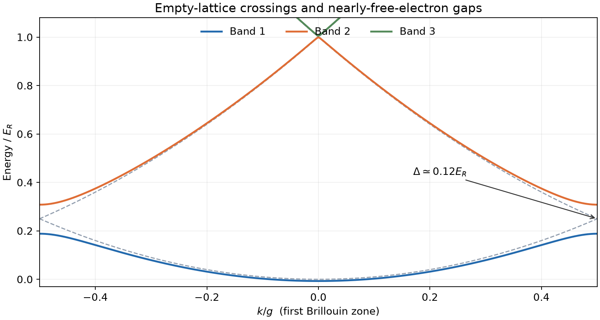
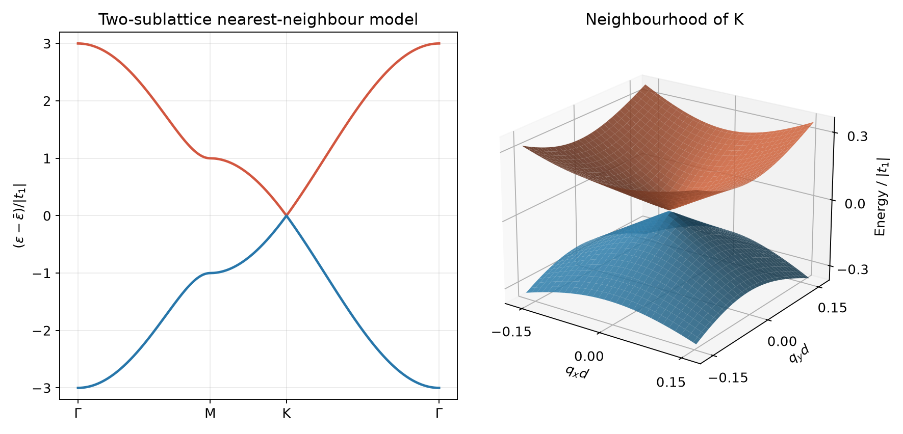
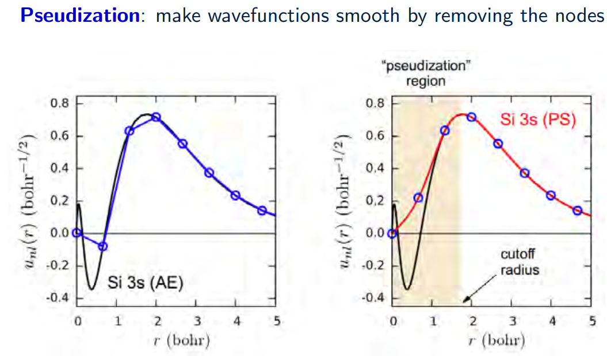

# 固体物理学习笔记

以中国科学院大学「固体物理（2班）」课件为主线，按概念、物理图像、推导和应用整理。授课教师：王峙、魏大海。本文覆盖现有 14 份课件、共 551 页，更新日期：2026-10-18。

**范围**：第一章晶体结构、第二章晶体结合、第三章晶格振动，以及第四章能带理论（一）至（六），包括电子统计与热容、半经典运动、紧束缚和基态密度泛函理论。电子输运与磁性的后续专章尚无对应课件；本文保留第四章涉及的入门内容，不延伸为这些专章的完整笔记。

## 阅读路线与课件索引

先理解「原子怎样排列」，再理解「为什么能够结合」，接着研究「原子怎样振动」，最后进入「电子怎样运动」。倒格子和第一布里渊区连接了晶体衍射、声子和能带，是贯穿全篇的共同语言。

| 编号 | 原课件文件名 | 页数 | 本文对应内容 |
| --- | --- | ---: | --- |
| S1 | 固体物理（2班）1.晶体结构（1） (1).pptx | 45 | 晶格与基元、原胞、立方格子 |
| S2 | 固体物理（2班）1.晶体结构（2） (1).pptx | 58 | 晶向晶面、点群、晶系、典型结构 |
| S3 | 固体物理（2班）1.晶体结构（3） (1).pptx | 38 | 衍射条件、倒格子、布里渊区 |
| S4 | 固体物理（2班）1.晶体结构（4） (1).pptx | 58 | Ewald 球、结构因子、实验方法 |
| S5 | 固体物理（2班）2.晶体结合 (1).pptx | 44 | 结合能、成键、离子晶体平衡 |
| S6 | 固体物理（2班）3.晶格振动（1） (1).pptx | 47 | 单原子链、双原子链、色散推导 |
| S7 | 固体物理（2班）3.晶格振动（2）.pptx | 40 | 简正坐标、声子、非简谐效应 |
| S8 | 固体物理（2班）3.晶格振动（3）.pptx | 44 | 热容、爱因斯坦模型、德拜模型 |
| S9 | 固体物理（2班）4.能带理论（1）.pptx | 31 | 三种近似、自由电子、势阱 |
| S10 | 固体物理（2班）4.能带理论（2）.pptx | 29 | Bloch 定理、中心方程、空晶格 |
| S11 | 固体物理（2班）4.能带理论（3）.pptx | 26 | 近自由电子、简并微扰与带隙 |
| S12 | 固体物理（2班）4.能带理论（4）.pptx | 31 | 态密度、费米统计、热容、半经典运动 |
| S13 | 固体物理（2班）4.能带理论（5）.pptx | 27 | 紧束缚、简单立方轨道、石墨烯 |
| S14 | 固体物理（2班）4.能带理论（6）.pptx | 33 | Hartree／HF、HK／KS、自洽与赝势 |

下文的「S3，第 21–24 页」指 PowerPoint 文件内的幻灯片序号。重复的小结、照片和历史介绍合并整理，核心公式与例题保留。课件文件中有晚于本次更新日的计划授课日期，本文按收到的文件整理，不据此判断实际授课进度。

### 新增课件的学习路线

| 学习目标 | 建议顺序 | 学完应能完成的任务 |
| --- | --- | --- |
| 看懂周期电子态 | 4.6–4.9 | 区分 Bloch 相位与周期部分，写中心方程，解释折叠为何不自动开隙 |
| 会解弱周期势 | 4.10–4.11 → 例 7 | 从傅里叶分量找耦合，筛选简并点，选择两态或多态矩阵 |
| 联系电子热学与运动 | 4.12–4.17 → 例 9、10 | 正确数态，固定粒子数求化学势，区分热容、速度与有效质量 |
| 从轨道理解能带 | 4.18–4.21 → 例 8 | 写最近邻模型，判断简并、带宽与石墨烯接触点 |
| 理解第一性原理的主线 | 4.22–4.26 | 分清能量泛函、KS 本征值、SCF 收敛与数值收敛 |

第一次阅读可先掌握 Bloch 形式、中心方程、两态开隙、三维自由电子 DOS、电子热容与最近邻 TB 六个结果；第二遍再复现推导，并检查每个结果的前提。DFT 部分需要变分和泛函的概念，可在前述能带模型之后学习。

### 学习时需要的基础

| 内容 | 先备知识 | 可以先掌握的结论 |
| --- | --- | --- |
| 晶格、倒格子、衍射 | 向量点乘、叉乘、复指数 | 原胞计数、$\mathbf b_i\cdot\mathbf a_j=2\pi\delta_{ij}$、Bragg 定律 |
| 结合能与平衡 | 一阶／二阶导数、链式法则 | 势阱极小值、$p=-dU/dV$ |
| 一维链 | 牛顿方程、简谐运动 | 集体振动、色散、声学／光学支 |
| 声子与热容 | 谐振子能级、玻色分布、积分 | 模式能量量子化、低温模式冻结、$T^3$ 律 |
| 单电子模型 | 薛定谔方程、归一化、边界条件 | 波函数形状、允许能级和穿透尾部 |
| 周期势与能带 | 傅里叶级数、厄米矩阵、微扰论 | Bloch 定理、分支耦合、简并处对角化 |
| 电子热学与运动 | 费米分布、定积分、二阶导数 | 费米面、低温热容、群速度和有效质量 |
| 密度泛函 | 变分、轨道正交、泛函导数 | 从密度构造有效势并迭代至自洽 |

初学时先读每节定义和比较表，再自行复现方框公式的推导。复习时可从文末例题倒推所需概念，最后用自测题检查是否能独立解释物理意义。

### 符号约定

| 符号 | 含义与约定 |
| --- | --- |
| $\mathbf a_i,\mathbf R$ | 正格子原始基矢、布拉维格矢 |
| $\mathbf b_i,\mathbf G$ | 倒格子基矢、倒格矢，采用含 $2\pi$ 的定义 |
| $a$ | 立方格子的惯用晶格常数；链模型中按该节另行定义 |
| $N_c,s,N_{\mathrm{at}}$ | 原胞数、每原胞原子数、总原子数，$N_{\mathrm{at}}=sN_c$ |
| $\beta$ | 一维链最近邻力常数，单位 $\mathrm{N/m}$ |
| $q,\mathbf q$ | 格波或声子的波矢 |
| $\omega,\nu$ | 角频率、振动分支编号；普通频率写成 $f=\omega/(2\pi)$ |
| $n_{\mathbf q\nu},\bar n$ | 某模式的声子占据数、热平均占据数 |
| $C_V,c_V$ | 样品总等容热容、单位体积等容热容 |
| $E_b$ | 本课采用的每原子结合能，稳定结合时为负值 |
| $\Omega,\mathcal V,N_e,n_e$ | 原胞体积、晶体体积、电子数、平均电子数密度，$\mathcal V=N_c\Omega$、$n_e=N_e/\mathcal V$ |
| $n(\mathbf r)$ | 空间分辨的电子粒子数密度，不是负电荷密度 |
| $\mathbf k,n,\varepsilon_n(\mathbf k)$ | 电子 Bloch 波矢、能带编号和色散；局部上下文中 $n$ 也可作密度函数名 |
| $V_{\mathbf Q},\bar V$ | 周期势的傅里叶系数及平均势 $V_{\mathbf0}$；$U_0,U_1$ 专用于课件势的振幅 |
| $D,\mathcal D$ | 总电子 DOS 与单位体积 DOS，$D=\mathcal V\mathcal D$；自旋是否计入需声明 |
| $E_F,\mu,T_F$ | 金属零温费米能、有限温度化学势、费米温度 |
| $e,t_1,J$ | $e>0$ 是元电荷；$t_1$ 为带符号的 TB 跃迁；$J>0$ 用于 $-2J\cos ka$ 模型 |
| $E,\varepsilon,\epsilon_i$ | $E$ 可表示总能量／泛函值，$\varepsilon$ 为模型单电子能量，$\epsilon_i$ 专指 KS 本征值；电场写 $\mathbf E$ 或局部一维 $E$ |

## 第一章　晶体结构

### 1.1 晶格与基元

来源：S1，第 7–17、38–39 页。

周期晶体具有长程周期性。非晶体可以保留近邻配位等短程有序，但缺乏长程平移周期；准晶具有长程有序，却没有普通三维周期晶格的平移周期。

布拉维格子是所有整数线性组合的端点集合：

$$
\mathbf R=n_1\mathbf a_1+n_2\mathbf a_2+n_3\mathbf a_3,
\qquad n_i\in\mathbb Z.
$$

各格点在平移意义下等价。给每个格点放置相同的原子组合，才能得到具体晶体：

$$
\text{晶体结构}=\text{布拉维格子}+\text{基元},\qquad
\mathbf r_{\mathbf R\kappa}=\mathbf R+\vec{\tau}_\kappa.
$$

$\vec{\tau}_\kappa$ 给出基元内第 $\kappa$ 个原子的位置，原子种类也必须注明。「一个格点」与「一个原子」只有在单原子基元时才可等同。

**石墨烯**：蜂窝排列包含两个在晶格平移下不等价的子格，布拉维格子是二维三角格子，基元含两个碳原子。若最近邻 C—C 距离为 $d$，可取

$$
\mathbf a_1=\frac{3d}{2}\hat{\mathbf x}-\frac{\sqrt3d}{2}\hat{\mathbf y},
\quad
\mathbf a_2=\frac{3d}{2}\hat{\mathbf x}+\frac{\sqrt3d}{2}\hat{\mathbf y},
$$

$$
\vec{\tau}_A=0,\qquad
\vec{\tau}_B=\frac{\mathbf a_1+\mathbf a_2}{3}.
$$

原始基矢长度为 $\sqrt3d$。不能仅凭六边形图案把蜂窝排列看成单原子布拉维格子；原胞内的原子数应按共享关系计数，仍为 2。

{ width="460" }

图源：S1，第 16 页。两种颜色区分两个子格，均为碳原子。

### 1.2 原胞、惯用单胞与超胞

来源：S1，第 18–20、33–40 页。

原胞含一个布拉维格点，体积

$$
\Omega=\left|\mathbf a_1\cdot(\mathbf a_2\times\mathbf a_3)\right|.
$$

同一晶格可以选取不同原始基矢；原胞形状随之改变，体积保持不变。若每个基元含 $s$ 个原子，则一个原胞含 $s$ 个原子。

Wigner–Seitz（WS）原胞的构造：选一个格点，连接周围格点，作连线的垂直平分面，取最靠近中心格点的区域。必要时需考虑更远邻格点，直到边界完整。它是具有晶格点群对称性的原胞。

惯用单胞突出晶格对称性，可能含多个格点。超胞由原胞或惯用单胞作整数倍扩展，便于描述缺陷、掺杂和计算模型。

{ width="500" }

图源：S1，第 19 页，保留课件图中的原始标记。不同形状的原胞含相同格点数、具有相同面积。

### 1.3 三种立方布拉维格子

来源：S1，第 21–32 页。

下表的 $a$ 均为惯用立方单胞的边长，且讨论单原子基元。

| 格子 | 惯用胞格点数 | 原胞体积 | 最近邻距离 | 配位数 | 实空间 WS 原胞 |
| --- | ---: | --- | --- | ---: | --- |
| SC | 1 | $a^3$ | $a$ | 6 | 立方体 |
| BCC | 2 | $a^3/2$ | $\sqrt3a/2$ | 8 | 截角八面体 |
| FCC | 4 | $a^3/4$ | $a/\sqrt2$ | 12 | 菱形十二面体 |

可选取以下原始基矢：

$$
\begin{aligned}
\mathrm{SC}:\quad&\mathbf a_1=a(1,0,0),\quad
\mathbf a_2=a(0,1,0),\quad\mathbf a_3=a(0,0,1),\\
\mathrm{BCC}:\quad&\mathbf a_1=\frac a2(-1,1,1),\quad
\mathbf a_2=\frac a2(1,-1,1),\quad\mathbf a_3=\frac a2(1,1,-1),\\
\mathrm{FCC}:\quad&\mathbf a_1=\frac a2(0,1,1),\quad
\mathbf a_2=\frac a2(1,0,1),\quad\mathbf a_3=\frac a2(1,1,0).
\end{aligned}
$$

**计数方法**：惯用立方胞的顶角贡献 $1/8$，棱上贡献 $1/4$，面上贡献 $1/2$，胞内贡献 1。这些分数来自相邻单胞的共享关系。

### 1.4 晶向、晶面和密勒指数

来源：S2，第 3–12 页。

晶向 $[uvw]$ 表示与 $u\mathbf a+v\mathbf b+w\mathbf c$ 平行的方向，通常采用惯用单胞基矢并约成最小整数比。负指数用上横线，如 $[\bar110]$。

晶面指数 $(hkl)$ 的截距法：

1. 用所选晶胞的轴长为单位写出三个截距。
2. 取倒数，平行于某轴时该项为 0。
3. 化为最小整数比；通过原点的面先平移到同族另一平面。

截距 $(1,2,3)$ 给出 $(632)$，截距 $(3,\infty,1)$ 给出 $(103)$。

| 写法 | 表示对象 |
| --- | --- |
| $[uvw]$ | 一个晶向 |
| $\langle uvw\rangle$ | 对称性等价的晶向族 |
| $(hkl)$ | 指定取向的晶面或晶面族 |
| $\{hkl\}$ | 对称性等价的晶面族 |

立方晶体中 $(hkl)$ 的法线平行于 $[hkl]$，一般晶系需要用倒格矢求法线。反向晶向具有相同的直线取向，但作为有向矢量并不相同；是否对称等价还要检查晶体点群。

六方晶体的晶面常用四指数 $(hkil)$，其中 $i=-(h+k)$。三个底面轴等价，使六重对称性更清楚。**晶向**的四指数转换另有规则，不能把晶面的截距法直接用于晶向。

### 1.5 对称操作、点群和空间群

来源：S2，第 13–34、42–44 页。

对称性是系统在变换下的不变性。点对称操作包括恒等、旋转、镜面反射、中心反演及其复合。对称元素是轴、面、中心等几何对象，操作是对空间点执行的变换。

| 操作 | Schoenflies 记号 | 国际记号 |
| --- | --- | --- |
| 恒等 | $E$ | $1$ |
| $n$ 重旋转 | $C_n$ | $n$ |
| 镜面反射 | $\sigma$ | $m$ |
| 中心反演 | $i$ | $\bar1$ |
| 旋转后反射／反演 | $S_n$ 表示旋转后水平镜面反射 | $\bar n$ 表示旋转后反演 |

$S_n$ 与 $\bar n$ 的定义不同，不能按相同下标直接替换。例如 $S_2=i$，$S_4$ 与 $\bar4$ 生成相同的一组操作。

对称操作构成群，满足封闭性、结合律、存在单位元和每个元素存在逆元。结合律不等于交换律，连续施加两次旋转通常与操作顺序有关。

三维周期晶体的点群有 32 类，空间群有 230 类。空间群还包括平移、螺旋轴、滑移面等操作。点群可理解为去掉空间群操作的平移部分后得到的旋转／反射类型群。

下面按晶系列出 32 类点群。国际记号中的上横线表示旋转反演；数字及镜面的位置编码相应的对称方向。

| 晶系 | 国际记号 | Schoenflies 记号 | 类数 |
| --- | --- | --- | ---: |
| 三斜 | $1,\bar1$ | $C_1,C_i$ | 2 |
| 单斜 | $2,m,2/m$ | $C_2,C_s,C_{2h}$ | 3 |
| 正交 | $222,mm2,mmm$ | $D_2,C_{2v},D_{2h}$ | 3 |
| 四方 | $4,\bar4,4/m,422,4mm,\bar42m,4/mmm$ | $C_4,S_4,C_{4h},D_4,C_{4v},D_{2d},D_{4h}$ | 7 |
| 三方 | $3,\bar3,32,3m,\bar3m$ | $C_3,C_{3i},D_3,C_{3v},D_{3d}$ | 5 |
| 六方 | $6,\bar6,6/m,622,6mm,\bar6m2,6/mmm$ | $C_6,C_{3h},C_{6h},D_6,C_{6v},D_{3h},D_{6h}$ | 7 |
| 立方 | $23,m\bar3,432,\bar43m,m\bar3m$ | $T,T_h,O,T_d,O_h$ | 5 |

$C_{3i}$ 也常写作 $S_6$。记号对照可核查 [IUCr 的国际表入门文章](https://journals.iucr.org/j/issues/2010/05/02/kk5061/index.html)。先掌握各类操作及典型结构的对称性，再用表查名称，比孤立背诵符号更容易理解。

**晶体学限制**：周期晶格的旋转阶数只允许 $1,2,3,4,6$。在适当的原始基矢下，旋转保持晶格整数坐标，其矩阵迹是整数。三维绕轴旋转的迹为 $1+2\cos\theta$，因此

$$
2\cos\theta\in\{-2,-1,0,1,2\}.
$$

对应 $\theta=\pi,2\pi/3,\pi/2,\pi/3,0$。准晶缺乏这里要求的周期平移格子，可以具有五重旋转对称。

**Neumann 原理**：晶体宏观物理性质的对称性至少包含晶体点群的对称性。例如立方晶体的对称二阶电导张量简化为 $\sigma_{ij}=\sigma\delta_{ij}$；更高阶性质仍可能表现出各向异性。

### 1.6 七个晶系与十四种布拉维格子

来源：S2，第 35–41 页。

晶系按晶体点群分类；晶格系统按布拉维格子的对称性分类。「三方晶系」和「菱方格子」处在不同分类层次。

| 晶系 | 识别对称性 | 常用晶胞描述 | 相关格子类型 |
| --- | --- | --- | --- |
| 三斜 | 无非平凡旋转，可能有反演 | 一般 $a,b,c,\alpha,\beta,\gamma$ | P |
| 单斜 | 一条二重轴或一个镜面 | 常取 $\alpha=\gamma=90^\circ$ | P、C |
| 正交 | 三条正交二重轴或相关镜面 | 三轴互相垂直 | P、C、I、F |
| 四方 | 一条四重轴或四重反演轴 | $a=b$，三轴互相垂直 | P、I |
| 三方 | 一条三重轴或三重反演轴 | 可用六方轴；菱方原胞也常用 | 可兼容六方 P 或菱方 R |
| 六方 | 一条六重轴或六重反演轴 | $a=b$，$\alpha=\beta=90^\circ,\gamma=120^\circ$ | 六方 P |
| 立方 | 四条三重轴 | $a=b=c$，三轴互相垂直 | P、I、F |

十四类的计数应按**晶格系统**进行：三斜 1、单斜 2、正交 4、四方 2、菱方 1、六方 1、立方 3，总数 14。晶胞参数的数值相等可能是偶然的，晶系最终由对称性决定。

**课件例子订正**：S2 第 38 页将两个例子的格子类型对调了。α 石英属于三方晶系，具有六方 P 格子（常见空间群 $P3_121$ 或其手性伙伴 $P3_221$）；刚玉属于三方晶系，具有菱方 R 格子，空间群 $R\bar3c$。刚玉可以用六方轴描述惯用胞，这不把它的 R 格子变成 P 格子。核对来源：[AFLOW α 石英](https://aflow.org/prototype-encyclopedia/A2B_hP9_152_c_a-001/)与[AFLOW 刚玉](https://aflow.org/prototype-encyclopedia/A2B3_hR10_167_c_e-001/)；分类层次参考 [IUCr 命名说明](https://www.iucr.org/who-we-are/commissions/commission-on-crystallographic-nomenclature/published-reports/bravais)。

### 1.7 典型晶体结构

来源：S1，第 36–39 页；S2，第 45–55 页。

下表的分数坐标以对应惯用胞为基准。「基元代表」表示在每个布拉维格点放置的原子组合。

| 结构 | 布拉维格子与基元代表 | 每原胞原子数 | 近邻配位 | 空间群 |
| --- | --- | ---: | --- | --- |
| 金刚石 | FCC；同种原子 $(0,0,0),(1/4,1/4,1/4)$ | 2 | 4 | $Fd\bar3m$，227 |
| 闪锌矿 | FCC；两种原子 $(0,0,0),(1/4,1/4,1/4)$ | 2 | 各 4 | $F\bar43m$，216 |
| 岩盐 NaCl | FCC；两种原子 $(0,0,0),(1/2,0,0)$ | 2 | 各 6 | $Fm\bar3m$，225 |
| CsCl | SC；两种原子 $(0,0,0),(1/2,1/2,1/2)$ | 2 | 各 8 | $Pm\bar3m$，221 |
| 萤石 CaF$_2$ | FCC；Ca $(0,0,0)$，F $(1/4,1/4,1/4),(3/4,3/4,3/4)$ | 3 | Ca 为 8，F 为 4 | $Fm\bar3m$，225 |
| 纤锌矿 | 六方 P；基元含 2 个阳离子和 2 个阴离子 | 4 | 各 4 | $P6_3mc$，186 |
| 理想立方钙钛矿 $AB\mathrm O_3$ | SC；A 在角、B 在体心、O 在三个面心 | 5 | B—O 为 6，A—O 为 12 | $Pm\bar3m$，221 |
| 2H 相层状 TMD | 六方 P；两层 $MX_2$ 构成基元 | 6 | 金属对硫族原子为 6 | $P6_3/mmc$，194 |

CsCl 的体心位置与顶角位置原子不同，交换两者的平移不保持结构，因此它的布拉维格子是 SC。同样的几何图形若全由同一种原子组成，才成为 BCC。

**补充：密堆积**。FCC 的堆垛序列为 ABCABC，HCP 为 ABAB，二者配位数都是 12，理想硬球填充率都是 $\pi/(3\sqrt2)\approx0.7405$。HCP 是六方布拉维格子加双原子基元，不是第十五种布拉维格子。

### 1.8 倒格子

来源：S3，第 15–25、34–35 页。

倒格矢的严格定义是

$$
e^{i\mathbf G\cdot\mathbf R}=1\quad\text{对所有 }\mathbf R,
\qquad\mathbf G=h\mathbf b_1+k\mathbf b_2+l\mathbf b_3.
$$

相应的基矢满足

$$
\mathbf b_i\cdot\mathbf a_j=2\pi\delta_{ij},
$$

$$
\mathbf b_1=2\pi\frac{\mathbf a_2\times\mathbf a_3}{\mathbf a_1\cdot(\mathbf a_2\times\mathbf a_3)},
\quad\mathbf b_2,\mathbf b_3\text{ 由循环置换得到}.
$$

正、倒原胞体积满足 $\Omega\Omega^*=(2\pi)^3$。倒格矢单位为长度的倒数。

若晶面使用某组晶胞轴的指数，求法线时必须使用与**同一组轴互为对偶**的倒易基矢：

$$
\mathbf G_{hkl}\perp(hkl),\qquad
d_{hkl}=\frac{2\pi}{|\mathbf G_{hkl}|}.
$$

立方惯用胞下

$$
d_{hkl}=\frac a{\sqrt{h^2+k^2+l^2}}.
$$

若使用 FCC/BCC 的惯用胞指数，形式上的 $(hkl)$ 法线不一定落在真正倒格子的格点上，需结合中心化条件判断。

**傅里叶含义**：周期密度可写为

$$
\rho(\mathbf r)=\sum_{\mathbf G}\rho_{\mathbf G}e^{i\mathbf G\cdot\mathbf r}.
$$

允许的傅里叶波矢形成倒格子，系数由基元和电子密度决定。衍射测得的是散射振幅的模平方；基元散射因子会改变峰强并导致消光。

### 1.9 立方格子的倒格子与第一布里渊区

来源：S3，第 26–33、36–37 页。

将 1.3 节的原始基矢代入，可得

$$
\begin{aligned}
\mathrm{BCC}:\quad&\mathbf b_1=\frac{2\pi}{a}(0,1,1),\quad
\mathbf b_2=\frac{2\pi}{a}(1,0,1),\quad\mathbf b_3=\frac{2\pi}{a}(1,1,0),\\
\mathrm{FCC}:\quad&\mathbf b_1=\frac{2\pi}{a}(-1,1,1),\quad
\mathbf b_2=\frac{2\pi}{a}(1,-1,1),\quad\mathbf b_3=\frac{2\pi}{a}(1,1,-1).
\end{aligned}
$$

| 正格子 | 倒格子 | 倒格子惯用立方边长 | 第一布里渊区形状 |
| --- | --- | --- | --- |
| SC | SC | $2\pi/a$ | 立方体 |
| BCC | FCC | $4\pi/a$ | 菱形十二面体 |
| FCC | BCC | $4\pi/a$ | 截角八面体 |

第一布里渊区是倒格子中以原点为中心的 WS 原胞，体积为 $(2\pi)^3/\Omega$。正格子 WS 原胞和第一布里渊区位于不同空间，BCC/FCC 两行的形状尤其容易混淆。

{ width="500" }

图源：S3，第 31 页。FCC 的倒格子为 BCC，因此区形状为截角八面体；$\Gamma$ 位于区中心，其他字母标注高对称点。

### 1.10 Bragg 条件、Laue 条件与 Ewald 球

来源：S3，第 3–14 页；S4，第 4–19 页。

晶面的相邻散射波光程差为 $2d\sin\theta$，相长干涉要求

$$
2d\sin\theta=n\lambda.
$$

$\theta$ 是入射波与晶面的夹角，实验横轴通常是 $2\theta$。现代指标常将级次 $n$ 吸收进 $(nh,nk,nl)$，写成 $2d_{hkl}\sin\theta=\lambda$。

令入射、出射波矢为 $\mathbf k,\mathbf k'$，散射矢量为 $\mathbf Q=\mathbf k'-\mathbf k$。弹性散射满足

$$
|\mathbf k|=|\mathbf k'|=\frac{2\pi}{\lambda},\qquad
\mathbf Q=\mathbf G.
$$

这就是 Laue 条件；也可写成 $\mathbf Q\cdot\mathbf a_i=2\pi m_i$。矢量符号反向不影响最终条件，因为倒格子含 $\pm\mathbf G$。

由 $|\mathbf k+\mathbf G|=|\mathbf k|$ 得

$$
2\mathbf k\cdot\mathbf G+G^2=0.
$$

在倒易空间，Ewald 球中心位于 $-\mathbf k$、半径 $2\pi/\lambda$，且经过倒格子原点。固定入射方向时，落在球面上的倒格点满足衍射几何条件；还需结构因子非零。

允许改变晶体取向时，可达倒格矢满足 $G\le4\pi/\lambda$，形成限域球。波长变短时，两种球的半径变大，但某一固定取向下实际亮斑数还取决于几何、探测范围和峰强。

| 方法 | 波长 | 晶体取向 | 主要思路 |
| --- | --- | --- | --- |
| Laue 法 | 连续谱 | 固定 | 改变 Ewald 球半径以获得多个反射 |
| 转晶法／Weissenberg 法 | 单色 | 转动 | 让不同倒格点依次经过球面 |
| 粉末法（补充） | 通常单色 | 大量随机取向晶粒 | 同一面间距的反射形成圆锥或环 |

### 1.11 结构因子与消光

来源：S4，第 20–27 页。

将晶体散射振幅分解为晶格求和与胞内原子求和：

$$
A(\mathbf Q)\propto\sum_{\mathbf R}e^{-i\mathbf Q\cdot\mathbf R}
\underbrace{\sum_jf_j(\mathbf Q)e^{-i\mathbf Q\cdot\vec{\tau}_j}}_{S(\mathbf Q)}.
$$

$f_j$ 是原子散射因子，$S$ 是结构因子。采用惯用胞时，要列出该胞内的全部原子：

$$
S_{hkl}=\sum_{j\in\mathrm{cell}}f_j
e^{-2\pi i(hx_j+ky_j+lz_j)},\qquad
I_{hkl}\propto|S_{hkl}|^2.
$$

对于相同原子的单原子 SC、BCC、FCC：

$$
\begin{aligned}
S_{\mathrm{SC}}&=f,\\
S_{\mathrm{BCC}}&=f\left[1+e^{-i\pi(h+k+l)}\right],\\
S_{\mathrm{FCC}}&=f\left[1+e^{-i\pi(k+l)}+e^{-i\pi(h+l)}+e^{-i\pi(h+k)}\right].
\end{aligned}
$$

| 结构 | 允许反射 | 消光条件 |
| --- | --- | --- |
| 单原子 SC | 全部非零 $(hkl)$ | 无中心化消光 |
| 单原子 BCC | $h+k+l$ 为偶数 | $h+k+l$ 为奇数 |
| 单原子 FCC | $h,k,l$ 全奇或全偶 | 奇偶混合 |
| 金刚石 | 全奇；或全偶且 $h+k+l=4n$ | 混合；或全偶且 $h+k+l=4n+2$ |

金刚石是在 FCC 上增加 $(1/4,1/4,1/4)$ 的相同原子：

$$
S_{\mathrm{diamond}}=S_{\mathrm{FCC}}
\left[1+e^{-i\pi(h+k+l)/2}\right].
$$

全奇时 $|S|^2=32f^2$，全偶且和为 $4n$ 时 $|S|^2=64f^2$，其余消光。这些是忽略其他实验因子的结构因子强度。

NaCl 可取两种原子的相对位移为 $(1/2,1/2,1/2)$，它与前述 $(1/2,0,0)$ 相差一个 FCC 格矢。对于 FCC 允许反射，

$$
S_{hkl}=4\left[f_{\mathrm{Na}}+f_{\mathrm{Cl}}e^{-i\pi(h+k+l)}\right].
$$

全偶强度正比于 $16|f_{\mathrm{Na}}+f_{\mathrm{Cl}}|^2$，全奇正比于 $16|f_{\mathrm{Na}}-f_{\mathrm{Cl}}|^2$。不同原子的散射因子通常不同，因此全奇峰并不普遍消失。

### 1.12 晶体结构的实验研究方法

来源：S4，第 28–56 页。

| 方法 | 与什么相互作用 | 主要信息 | 理解边界 |
| --- | --- | --- | --- |
| XRD | 电子云 | 体相周期结构、晶格参数 | 峰强受基元与实验因素影响 |
| 低能电子衍射 LEED | 带电电子与样品强相互作用 | 表面周期结构 | 低能电子穿透较浅 |
| 中子衍射 | 原子核及磁矩 | 核位置、磁结构 | 散射能力并不简单随原子序数递增 |
| STM | 针尖与样品间的隧穿 | 表面形貌与局域电子态 | 对电子态敏感，图像不是原子核位置的直接照片 |
| AFM | 针尖与样品间作用力 | 表面形貌、局域相互作用 | 分辨率和对比取决于针尖、模式和环境 |

非相对论粒子的德布罗意关系为 $\lambda=h/\sqrt{2mE}$。电子近似有 $\lambda(\mathrm{nm})\approx1.227/\sqrt{E(\mathrm{eV})}$，中子约为 $0.0286/\sqrt{E(\mathrm{eV})}$。高能电子需考虑相对论修正。

STM 的距离敏感性可写为 $I\propto e^{-2\kappa d}$，其中 $\kappa\approx\sqrt{2m_e\Phi}/\hbar$，$\Phi$ 是有效势垒高度。针尖高度变化很小，就能使电流显著变化。

## 第二章　晶体结合

### 2.1 结合能、稳定性与能量约定

来源：S5，第 3–7 页。

本课把每原子结合能定义为形成晶体后的能量减去孤立组成粒子的能量：

$$
E_b=\frac{E_{\mathrm{crystal}}-\sum_i n_iE_i^{\mathrm{isolated}}}{\sum_i n_i}.
$$

稳定结合时 $E_b<0$。有些教材以拆散晶体所需的能量定义结合能，取正值。孤立参考粒子是中性原子还是离子、能量是每原子还是每离子对，都必须说明。

在零温和近似零外压下，比较内能极小值；恒温恒容比较 $F=U-TS$，恒温恒压比较 $G=U+pV-TS$。负结合能不能单独证明某晶相在给定温压下是最稳定相，还要与竞争相比较。

在两体中心势近似下

$$
U\approx\frac12\sum_{i\ne j}\phi(r_{ij}),\qquad
F_r=-\frac{d\phi}{dr}.
$$

系数 $1/2$ 避免每对原子重复计数。远距离吸引与近距离排斥形成势阱，对于单个两体势阱，稳定平衡满足

$$
\phi'(r_0)=0,\qquad\phi''(r_0)>0.
$$

晶体的平衡与稳定性应对总能量 $U$ 求导；一般不要求每一对原子的距离都位于各自两体势的极小值。

排斥势常用 $b/r^n$ 或 $\lambda_0e^{-r/\sigma}$ 表示。电子云重叠时泡利不相容及动能等贡献使能量升高，不能简单把泡利排斥当作一种额外的基本力。

### 2.2 电离能、电子亲和能与电负性

来源：S5，第 10–17 页。

电离能是气态原子失去电子所需的能量；电子亲和能在本课中取获得电子释放的能量为正；电负性描述成键环境中吸引电子的相对能力。

Mulliken 定义为 $\chi=(I+A)/2$，若 $I,A$ 以 eV 计，则未经标度变换的 $\chi$ 也有能量单位。Pauling 标度为无量纲相对标度，依据异核键额外稳定能估计电负性差。

电负性差大通常意味着离子性增强，差小通常意味着共价性增强。课件中的 1.7 等分界是经验判断，成键性质连续变化，不能将它当作普适的严格阈值。

### 2.3 成键类型与性质

来源：S5，第 8–9、28–43 页。

| 类型 | 主要图像 | 方向性 | 典型性质与例子 |
| --- | --- | --- | --- |
| 离子结合 | 正负离子的库仑吸引 | 一般较弱 | NaCl 等，通常熔点高、硬脆，固态电子导电弱 |
| 共价结合 | 原子共享电子，形成成键态 | 强 | 金刚石、Si、Ge；结构与电子轨道有关 |
| 金属结合 | 离子实与离域电子共同形成稳定结构 | 通常较弱 | Cu、Al 等；常具有较好的导电性与延展性 |
| 范德华结合 | 永久／诱导／涨落偶极相互作用 | 依分子取向而定 | 惰性气体晶体、分子晶体和层间结合 |
| 氢键 | $X-\mathrm H\cdots Y$ 的特定相互作用 | 明显 | 冰等；几何与电荷分布共同影响强度 |

这些是理解结构的模型，真实材料可能混合多种结合。例如石墨层内以共价结合为主，层间以范德华作用为主。硬度、熔点和结合能没有适用于所有材料的简单排序。

共价成键可用成键／反键轨道的形成理解。碳的 $sp^3$ 杂化给出四个四面体方向，夹角为 $\arccos(-1/3)\approx109.47^\circ$。例如

$$
\psi_1=\frac12(\phi_{2s}+\phi_{2p_x}+\phi_{2p_y}+\phi_{2p_z}),
$$

另外三个组合依次取符号 $(+,+,-,-)$、$(+,-,+,-)$、$(+,-,-,+)$，得到四个正交的杂化轨道。杂化是轨道表示和成键图像，不是孤立碳原子必须先经历的真实分步过程。

范德华相互作用包括永久偶极之间的 Keesom 作用、永久偶极诱导其他分子极化的 Debye 作用、量子涨落引起的 London 色散作用。常见的 $-C_6/r^6$ 是特定条件下的有效吸引形式；固定取向永久偶极的作用还具有方向依赖。

### 2.4 马德隆常数与离子晶体结合能

来源：S5，第 19–26 页。

考虑电荷为 $\pm q_e$ 的离子晶体，最近邻距离为 $r$，按**每离子对**计的结合能模型为

$$
U(r)=-\frac{A}{r}+\frac{B}{r^n},\qquad
A=\frac{Mq_e^2}{4\pi\varepsilon_0},\quad n>1.
$$

$M$ 是马德隆常数，由晶体的几何及正负电荷配置决定。对给定等价的电荷配置，缩放晶格不改变 $M$。NaCl 型一价离子晶体有 $M\approx1.74756$。

库仑晶格和不能任意重排，应采用符合电中性与物理边界条件的求和方法，例如 Ewald 求和。

平衡时

$$
\frac{dU}{dr}=\frac A{r^2}-\frac{nB}{r^{n+1}}=0,
\qquad B=\frac A n r_0^{n-1},
$$

$$
U(r_0)=-\frac A{r_0}\left(1-\frac1n\right),\qquad
U''(r_0)=\frac{(n-1)A}{r_0^3}>0.
$$

排斥项在平衡时为吸引项绝对值的 $1/n$，但它决定了平衡位置和势阱曲率，不能忽略。

### 2.5 从结合能求压力和体积模量

来源：S5，第 24–27 页。

对 NaCl 型晶体，惯用胞边长 $a=2r$，每个 FCC 原胞含一对离子，所以每离子对体积为

$$
v=\frac{a^3}{4}=2r^3,\qquad
\frac{dv}{dr}=6r^2.
$$

由 $p=-dU/dv$ 得

$$
p(r)=\frac A{6r^4}\left[\left(\frac{r_0}{r}\right)^{n-1}-1\right].
$$

当 $r<r_0$ 时，维持压缩需要正压力。体积模量为

$$
K=-v\frac{dp}{dv},\qquad
K_0=\frac{(n-1)A}{18r_0^4}.
$$

若晶格常数减小比例为 $\epsilon\ll1$，体积约减小 $3\epsilon$，所以 $p\approx3K_0\epsilon$。计算中 $U$ 与 $v$ 必须使用相同的计量单元。

## 第三章　晶格振动

### 3.1 简谐近似与一维单原子链

来源：S6，第 3–23、39 页。

本节每个原子质量为 $m$，相邻平衡间距及原胞长度都为 $a$，仅保留最近邻相互作用。第 $\ell$ 个原子坐标为 $x_\ell=\ell a+u_\ell$。

把相邻原子的势能在平衡处展开，忽略常数并保留二阶：

$$
\phi(a+u_{\ell+1}-u_\ell)
\approx\phi(a)+\frac12\beta(u_{\ell+1}-u_\ell)^2,
\quad\beta=\phi''(a).
$$

这里 $\phi'(a)=0$ 是无预应力的最近邻链模型的假设；一般晶体只要求总力在平衡处为零。

运动方程为

$$
m\ddot u_\ell=\beta(u_{\ell+1}+u_{\ell-1}-2u_\ell).
$$

代入 $u_\ell=Ae^{i(q\ell a-\omega t)}$，消去共同相位，得到

$$
-m\omega^2=\beta(e^{iqa}+e^{-iqa}-2)
=-4\beta\sin^2\frac{qa}{2},
$$

$$
\boxed{\omega(q)=2\sqrt{\frac\beta m}\left|\sin\frac{qa}{2}\right|}.
$$

实际位移取复数解的实部。非负频率必须保留绝对值，或先明确只讨论 $q\ge0$。

### 3.2 波矢、模式数量与传播速度

来源：S6，第 12–23 页。

Born–von Kármán 边界条件 $u_{\ell+N_c}=u_\ell$ 给出

$$
e^{iqN_ca}=1,\qquad q=\frac{2\pi j}{N_ca}.
$$

取第一布里渊区 $-\pi/a\le q<\pi/a$，其中恰有 $N_c$ 个不同波矢。两端点等价，不能重复计数。

由于 $e^{i(q+2\pi/a)\ell a}=e^{iq\ell a}$，$q$ 与 $q+G$ 描述相同的格点位移。分立波矢来自有限尺寸和周期边界，属于经典结果；模式能量的量子化是另一件事。

相速度 $v_p=\omega/q$，群速度 $v_g=d\omega/dq$。对正波矢区间

$$
v_g=a\sqrt{\frac\beta m}\cos\frac{qa}{2}.
$$

| 极限 | 频率 | 振动与传播 |
| --- | --- | --- |
| $q\to0$ | $\omega\approx v_s\lvert q\rvert$，$v_s=a\sqrt{\beta/m}$ | 相邻原子近同相，成为连续弹性波 |
| $\lvert q\rvert=\pi/a$ | $\omega_{\max}=2\sqrt{\beta/m}$ | 相邻原子反相，群速度为 0 |

区边界的群速度为零，原子仍在振动。用第一布里渊区的波矢代表定义波长时，最短代表波长为 $2a$。

### 3.3 一维双原子链

来源：S6，第 24–32、40–47 页。

本节严格沿用课件：最近邻距离为 $a$，原胞长度为 $2a$，质量 $m,M$ 交替排列，且 $M>m$，力常数均为 $\beta$。因此

$$
-\frac\pi{2a}\le q<\frac\pi{2a}.
$$

令轻、重原子振幅分别为 $A,B$，取

$$
u_{2\ell}=Ae^{i(2\ell aq-\omega t)},\qquad
u_{2\ell+1}=Be^{i((2\ell+1)aq-\omega t)}.
$$

代入牛顿方程：

$$
\begin{pmatrix}
2\beta-m\omega^2&-2\beta\cos(qa)\\
-2\beta\cos(qa)&2\beta-M\omega^2
\end{pmatrix}
\begin{pmatrix}A\\B\end{pmatrix}=0.
$$

非零解要求行列式为零，即

$$
mM\omega^4-2\beta(m+M)\omega^2+4\beta^2\sin^2(qa)=0.
$$

两条色散支为

$$
\boxed{
\omega_\pm^2(q)=\beta\left(\frac1m+\frac1M\right)
\pm\beta\sqrt{\left(\frac1m+\frac1M\right)^2
-\frac4{mM}\sin^2(qa)}
}.
$$

减号为声学支，正号为光学支，每支含 $N_c$ 个模式，总共 $2N_c$ 个，等于这个一维模型的自由度数。

| 情形 | 声学支 | 光学支 |
| --- | --- | --- |
| $q\to0$ | $\omega_-\approx a\sqrt{2\beta/(M+m)}\lvert q\rvert$；$B/A\to1$ | $\omega_+\to\sqrt{2\beta(1/m+1/M)}$；$B/A\to-m/M$ |
| $\lvert q\rvert=\pi/(2a)$ | $\omega_-^2=2\beta/M$；轻原子静止、重原子振动 | $\omega_+^2=2\beta/m$；重原子静止、轻原子振动 |

长波光学模满足 $mA+MB=0$，原胞质心不动。两支之间的频率禁带为

$$
\sqrt{2\beta/M}<\omega<\sqrt{2\beta/m}.
$$

在 $m=M$ 且力常数相同时，禁带闭合，结果相当于单原子链用更大原胞进行区折叠。

{ width="460" }

图源：S6，第 26–27 页。横轴边界为 $\pm\pi/(2a)$，这里的 $a$ 是最近邻间距。

光学支的名称来自极性晶体中的相对离子位移可产生振荡偶极，从而与光耦合。光学模是否红外活性或 Raman 活性，仍取决于对称性与选择定则。

### 3.4 三维晶体、动力学矩阵与简正坐标

来源：S6，第 33–37 页；S7，第 4–16、38–40 页。

三维晶体有 $N_c$ 个原胞，每胞 $s$ 个原子。每个波矢有 $3s$ 条振动支，其中 3 条声学支、$3s-3$ 条光学支，总模式数为 $3sN_c=3N_{\mathrm{at}}$。

在高对称方向或近各向同性极限下，声学模可分为 1 条纵向 LA 和 2 条横向 TA；一般方向上极化可能混合。

令 $u_{\kappa\alpha}(\mathbf R)$ 为第 $\kappa$ 个原子在 $\alpha$ 方向的位移，力常数矩阵为

$$
\Phi_{\kappa\alpha,\kappa'\beta}(\mathbf R,\mathbf R')
=\left.\frac{\partial^2U}
{\partial u_{\kappa\alpha}(\mathbf R)\partial u_{\kappa'\beta}(\mathbf R')}\right|_{u=0}.
$$

势能是位移的二次型，各原子运动相互耦合。采用质量加权和傅里叶变换，问题化为

$$
D(\mathbf q)\vec{\xi}_{\mathbf q\nu}
=\omega_{\mathbf q\nu}^2\vec{\xi}_{\mathbf q\nu}.
$$

例如采用 $e^{i\mathbf q\cdot\mathbf R}$ 的胞相位约定，

$$
D_{\kappa\alpha,\kappa'\beta}(\mathbf q)
=\frac1{\sqrt{m_\kappa m_{\kappa'}}}
\sum_{\mathbf R}\Phi_{\kappa\alpha,\kappa'\beta}(0,\mathbf R)
e^{i\mathbf q\cdot\mathbf R}.
$$

$D$ 是 $3s\times3s$ 矩阵，本征矢是极化矢量，本征值是 $\omega^2$。把基元位置也放入相位会改变矩阵及本征矢的表达，但不改变频率。

对应简正坐标可定义为

$$
Q_{\mathbf q\nu}=\frac1{\sqrt{N_c}}
\sum_{\mathbf R,\kappa,\alpha}
\sqrt{m_\kappa}\,\xi_{\kappa\alpha}^*(\mathbf q\nu)
u_{\kappa\alpha}(\mathbf R)e^{-i\mathbf q\cdot\mathbf R}.
$$

逆变换为

$$
u_{\kappa\alpha}(\mathbf R)=\frac1{\sqrt{N_cm_\kappa}}
\sum_{\mathbf q\nu}\xi_{\kappa\alpha}(\mathbf q\nu)
Q_{\mathbf q\nu}e^{i\mathbf q\cdot\mathbf R}.
$$

自由度由「原胞、原子、方向」改用「波矢、分支」描述，总数不变。实位移对应 $\pm\mathbf q$ 的复共轭约束，不能把每个复数坐标当作两个额外独立自由度。

选取独立的实简正坐标后，哈密顿量成为独立振子的和：

$$
H=\frac12\sum_j(P_j^2+\omega_j^2Q_j^2).
$$

动力学矩阵出现 $\omega^2<0$ 表示在该模型和参考结构下存在不稳定方向，通常以虚频表示。稳定晶体在 $\mathbf q=0$ 有三种整体平移零频模。

### 3.5 晶格振动的量子化与声子

来源：S7，第 17–26 页。

对每个非零频简正模进行量子化：

$$
[\hat Q_j,\hat P_{j'}]=i\hbar\delta_{jj'},\qquad
\hat H_j=\hbar\omega_j\left(\hat n_j+\frac12\right),
$$

$$
E_j(n_j)=\left(n_j+\frac12\right)\hbar\omega_j,
\qquad n_j=0,1,2,\ldots.
$$

声子是晶格振动的一份激发量子：每增加一个声子，模式能量增加 $\hbar\omega$。模式数固定，占据数可变；零点能 $\hbar\omega/2$ 属于该模式，即使声子数为零也存在。

声子具有晶格准动量 $\hbar\mathbf q$，其定义允许相差 $\hbar\mathbf G$。它描述晶体内部的集体激发，不能脱离介质作为同一种自由粒子存在。

热平衡下声子数不守恒，化学势为零：

$$
\bar n_j=\frac1{e^{\hbar\omega_j/(k_BT)}-1},\qquad
\langle E_j\rangle=\hbar\omega_j\left(\bar n_j+\frac12\right).
$$

对于质量加权坐标，

$$
\langle Q_j^2\rangle=\frac\hbar{\omega_j}\left(\bar n_j+\frac12\right).
$$

低温时非零频模式的 $\bar n$ 指数减小，仍保留零点涨落；高温 $k_BT\gg\hbar\omega$ 时 $\langle E_j\rangle\approx k_BT$，恢复经典能量均分。

高温展开时要保持相同精度：$\bar n=1/x-1/2+O(x)$，其中 $x=\hbar\omega/(k_BT)$。因此 $\hbar\omega(\bar n+1/2)$ 的常数项互相抵消；只取 $\bar n\approx1/x$ 再保留零点项，容易得到不一致的次阶近似。

### 3.6 非简谐效应、热膨胀与热传导

来源：S7，第 27–30 页。

严格简谐势关于平衡位置对称，升温增大位移涨落，但不改变平均位置。考虑三阶、四阶等非简谐项后，势能的不对称性及振动频率对体积的依赖才能产生热膨胀。

{ width="460" }

图源：S7，第 27 页。绿色曲线为简谐势，蓝色为非简谐势示意；水平线表示不同振动能级。

简谐模型中简正模互不散射。真实晶体的非简谐作用、缺陷和边界限制传播距离，使晶格热导有限。各向同性动力学近似为

$$
\mathbf j_Q=-\kappa\nabla T,\qquad
\kappa\approx\frac13c_Vv\ell,
$$

其中 $c_V$ 是单位体积热容，$v$ 是代表性群速度，$\ell$ 是平均自由程。使用样品总热容时应先除以体积。

**补充**：声子散射中，正常过程的波矢和不需要加倒格矢，Umklapp 过程需要加减非零倒格矢。正常过程单独并不等同于直接弛豫全部热流；热导计算还依赖其他散射机制及边界条件。

对于有限尺寸、边界限制平均自由程的普通三维绝缘晶体，低温 $c_V\propto T^3$，常得到晶格热导也趋近于零。无限理想简谐体系需用弹道输运理解，不能直接套用有限平均自由程的扩散公式。

### 3.7 声子谱的实验测量

来源：S7，第 31–36 页。

| 手段 | 主要信息 | 适用范围与限制 |
| --- | --- | --- |
| 非弹性中子散射 | 能量与动量转移，重建声子色散 | 可覆盖广泛波矢，需要中子源及合适样品 |
| Raman 散射 | 通常探测区中心附近的 Raman 活性振动 | 常用于光学声子、薄膜和二维材料表征 |
| Brillouin 散射 | 低频声学声子、声速和弹性信息 | 光学几何与穿透深度限制可测模式 |
| 泵浦—探测／超快电子衍射 | 非平衡晶格动力学和时间演化 | 需要结合激发、选择定则和时域模型分析 |

散射测量遵循能量守恒与晶格准动量守恒。普通一阶光散射因光子波矢较小，主要探测 $q\approx0$；高阶、多声子、缺陷辅助过程可以扩展这个范围。

### 3.8 热容与杜隆—珀蒂定律

来源：S8，第 3–19 页。

总等容热容为 $C_V=(\partial U/\partial T)_V$，等压热容为 $C_P=(\partial H/\partial T)_p$。许多固体中二者接近，但并非恒等。

每个经典谐振子的动能和势能各贡献 $k_BT/2$，三维晶体有 $3N_{\mathrm{at}}$ 个模式，因此

$$
U_{\mathrm{vib}}\approx3N_{\mathrm{at}}k_BT,\qquad
C_V\approx3N_{\mathrm{at}}k_B.
$$

每摩尔**原子**为 $3R\approx24.94\ \mathrm{J\,mol^{-1}K^{-1}}$；含 $s$ 个原子的化学式单位对应每摩尔化学式单位 $3sR$。

这一经典极限要求主要振动模式满足 $k_BT\gg\hbar\omega$。金刚石等高特征频率材料即使在室温也不一定达到该极限。

### 3.9 爱因斯坦热容模型

来源：S8，第 20–26 页。

假设 $3N_{\mathrm{at}}$ 个模式均有相同频率 $\omega_E$，定义 $\Theta_E=\hbar\omega_E/k_B$。则

$$
U_E=3N_{\mathrm{at}}\hbar\omega_E
\left(\frac12+\frac1{e^{\Theta_E/T}-1}\right),
$$

$$
\boxed{C_V^E=3N_{\mathrm{at}}k_B
\left(\frac{\Theta_E}{T}\right)^2
\frac{e^{\Theta_E/T}}{(e^{\Theta_E/T}-1)^2}}.
$$

高温恢复 $3N_{\mathrm{at}}k_B$；低温为

$$
C_V^E\approx3N_{\mathrm{at}}k_B(\Theta_E/T)^2e^{-\Theta_E/T}.
$$

它说明能量量子化能使低温热容下降，但单频谱缺少趋于零频率的声学模，因而不能给出普通三维晶体的低温 $T^3$ 律。它可近似描述窄频率范围的光学模，但模型本身并未逐一建立真实的光学分支。

### 3.10 德拜态密度与截止频率

来源：S8，第 27–31、37–42 页。

德拜模型用各向同性连续弹性波近似振动谱：一条纵支、两条横支，$\omega=v_Lq$ 或 $v_Tq$。每支在波矢空间的模式密度为 $V/(2\pi)^3$，所以

$$
g(\omega)=\frac{V\omega^2}{2\pi^2}
\left(\frac1{v_L^3}+\frac2{v_T^3}\right).
$$

定义平均声速 $v_D$：

$$
\frac1{v_D^3}=\frac13\left(\frac1{v_L^3}+\frac2{v_T^3}\right),
\qquad g(\omega)=\frac{3V\omega^2}{2\pi^2v_D^3}.
$$

截止频率通过模式总数归一化确定：

$$
\int_0^{\omega_D}g(\omega)d\omega=3N_{\mathrm{at}},
$$

$$
q_D=\left(\frac{6\pi^2N_{\mathrm{at}}}{V}\right)^{1/3},
\quad\omega_D=v_Dq_D,\quad
\Theta_D=\frac{\hbar\omega_D}{k_B}.
$$

也可写成 $g(\omega)=9N_{\mathrm{at}}\omega^2/\omega_D^3$，定义在 $0\le\omega\le\omega_D$。

{ width="420" }

图源：S8，第 29 页。球壳体积为 $4\pi q^2dq$，乘上每支波矢密度及分支数，才得到总模式数。

这是一种将全部 $3N_{\mathrm{at}}$ 个振动自由度用等效声学谱近似的热容模型。对于多原子原胞，真实声学支只有 $3N_c$ 个模式，光学支另占其余模式；德拜截止不等于真实晶体允许激发的严格边界。

### 3.11 德拜热容及高低温极限

来源：S8，第 32–36 页。

总振动能为

$$
U_D=\int_0^{\omega_D}g(\omega)\hbar\omega
\left(\frac12+\frac1{e^{\hbar\omega/(k_BT)}-1}\right)d\omega.
$$

在频率不随温度变化的模型中，零点能与温度无关，不贡献热容。令 $x=\hbar\omega/(k_BT)$，得

$$
\boxed{C_V^D=9N_{\mathrm{at}}k_B\left(\frac T{\Theta_D}\right)^3
\int_0^{\Theta_D/T}\frac{x^4e^x}{(e^x-1)^2}\,dx}.
$$

高温时 $e^x-1\approx x$，积分约为 $(\Theta_D/T)^3/3$，得到 $C_V^D\to3N_{\mathrm{at}}k_B$。

低温时将上限延至无穷大，使用

$$
\int_0^\infty\frac{x^4e^x}{(e^x-1)^2}dx=\frac{4\pi^4}{15},
$$

$$
\boxed{C_V^D\approx\frac{12\pi^4}{5}N_{\mathrm{at}}k_B
\left(\frac T{\Theta_D}\right)^3}.
$$

$T^3$ 来自三维线性色散声学模的 $g(\omega)\propto\omega^2$。低温晶格贡献由长波声学模主导，不代表所有温度下光学模都可忽略。

**补充：金属低温热容**常写为 $C_V\approx\gamma T+AT^3$。第一项来自电子，第二项来自晶格；这不是把电子项纳入德拜模型。

### 3.12 热容模型比较

| 模型 | 谱的假设 | 高温晶格热容 | 低温行为 | 主要适用意义 |
| --- | --- | --- | --- | --- |
| 经典均分 | 能量连续 | $3N_{\mathrm{at}}k_B$ | 错误地保持常数 | 高温极限 |
| 爱因斯坦 | 单一非零频率 | $3N_{\mathrm{at}}k_B$ | 指数减小 | 体现量子化，近似窄谱模式 |
| 德拜 | 连续线性色散，$g\propto\omega^2$ | $3N_{\mathrm{at}}k_B$ | $T^3$ | 普通三维晶体低温晶格热容 |

## 第四章　能带理论

本章沿 S9–S14 展开：先由单电子近似进入周期势，接着用近自由电子与紧束缚解释能带，再用统计和半经典方程联系热学、输运，最后讨论如何通过密度泛函自洽地确定有效势。

### 4.1 多体哈密顿量与三种近似

来源：S9，第 4–16、30 页。

电子坐标为 $\mathbf r_i$，原子核坐标为 $\mathbf R_I$，原子核电荷为 $Z_Ie$。非相对论库仑哈密顿量在 SI 制中为

$$
\begin{aligned}
\hat H={}&\sum_i\frac{\hat{\mathbf p}_i^2}{2m_e}
+\sum_I\frac{\hat{\mathbf P}_I^2}{2M_I}
+\frac12\sum_{i\ne j}\frac{e^2}{4\pi\varepsilon_0|\mathbf r_i-\mathbf r_j|}\\
&+\frac12\sum_{I\ne J}\frac{Z_IZ_Je^2}{4\pi\varepsilon_0|\mathbf R_I-\mathbf R_J|}
-\sum_{i,I}\frac{Z_Ie^2}{4\pi\varepsilon_0|\mathbf r_i-\mathbf R_I|}.
\end{aligned}
$$

电子—核项为负，电子—电子与核—核项为正。两个 $1/2$ 避免重复计数，求和排除同一粒子的自相互作用。

**Born–Oppenheimer 近似**：电子与核运动的时间尺度通常差别很大，先固定核位置求电子态及势能面，再处理核在势能面上的运动。

$$
\Phi(\mathbf r,\mathbf R)\approx\Psi_\alpha(\mathbf r;\mathbf R)\Xi_\alpha(\mathbf R).
$$

核坐标在电子方程中是参数。这个近似本身仍允许核的量子力学处理；将核运动写为经典牛顿方程是额外近似。低温声子热容仍需要对核的振动模式量子化。

**平均场／独立电子近似**：用有效单电子势代替显式多电子耦合，求解单粒子轨道，但电子的反对称性、占据和交换关联仍需在相应理论中处理。

**周期场近似**：理想静态周期晶体满足 $V_{\mathrm{eff}}(\mathbf r+\mathbf R)=V_{\mathrm{eff}}(\mathbf r)$。缺陷、表面和瞬时晶格振动可能破坏该理想周期性。

最终得到

$$
\left[-\frac{\hbar^2}{2m_e}\nabla^2+V_{\mathrm{eff}}(\mathbf r)\right]
\varphi(\mathbf r)=\varepsilon\varphi(\mathbf r).
$$

把电子自由度消去后得到的核有效势可能含多体项。因此「基本库仑哈密顿量含两体相互作用」与「经验原子势含三体或多体贡献」并不冲突。

### 4.2 自由电子与归一化

来源：S9，第 18–20 页。

一维自由电子满足

$$
-\frac{\hbar^2}{2m_e}\frac{d^2\varphi}{dx^2}=\varepsilon\varphi,
\quad\varphi_k(x)=Ae^{ikx},\quad
\varepsilon(k)=\frac{\hbar^2k^2}{2m_e}.
$$

无限空间的平面波是广义本征态，不能按普通平方可积函数归一化。可采用 $\delta$ 归一化，或先置于长度 $L$ 的周期盒中：

$$
\varphi_k(x)=\frac1{\sqrt L}e^{ikx},\quad
k=\frac{2\pi j}{L},\quad j\in\mathbb Z.
$$

有限盒中 $k$ 分立，$L\to\infty$ 时变为连续谱。实际局域粒子可用不同 $k$ 的平面波叠加成波包描述。

### 4.3 无限深势阱

来源：S9，第 21–24 页。

取 $V(x)=0$（$0<x<L$），区间外 $V=\infty$。边界条件 $\varphi(0)=\varphi(L)=0$ 给出

$$
\boxed{\varphi_n(x)=\sqrt{\frac2L}\sin\frac{n\pi x}{L}},
\qquad n=1,2,3,\ldots,
$$

$$
\boxed{\varepsilon_n=\frac{n^2\pi^2\hbar^2}{2m_eL^2}}.
$$

归一化来自 $\int_0^L\sin^2(n\pi x/L)dx=L/2$。$n=0$ 只给出零函数，不能作为量子态。波函数是驻波，不是单一动量本征态。

与周期盒比较：硬壁势阱给 $k_n=n\pi/L$，周期边界给 $k_j=2\pi j/L$。边界条件改变允许波矢和态计数。

课件思考题中的等间隔能级 $(n+1/2)\hbar\omega$ 对应谐振子势 $V(x)=m_e\omega^2x^2/2$，它与盒中粒子的 $n^2$ 能级规律不同。

### 4.4 有限深势阱

来源：S9，第 25–29 页。

取对称势阱，阱内 $V=0$（$|x|<L/2$），阱外 $V=V_0>0$。对于束缚态 $0<\varepsilon<V_0$，定义

$$
k=\frac{\sqrt{2m_e\varepsilon}}\hbar,\qquad
\alpha=\frac{\sqrt{2m_e(V_0-\varepsilon)}}\hbar.
$$

阱内解为正弦／余弦，阱外解为随 $|x|$ 增大而衰减的指数函数。对于相同质量、有限跳变的势能，波函数及一阶导数在边界连续。

偶宇称与奇宇称的匹配条件分别为

$$
k\tan\frac{kL}{2}=\alpha,\qquad
-k\cot\frac{kL}{2}=\alpha.
$$

令 $z=kL/2$、$z_0=(L/2)\sqrt{2m_eV_0}/\hbar$，则

$$
z\tan z=\sqrt{z_0^2-z^2}\quad\text{（偶态）},
$$

$$
-z\cot z=\sqrt{z_0^2-z^2}\quad\text{（奇态）},\qquad0<z<z_0.
$$

交点决定允许能量 $\varepsilon=2\hbar^2z^2/(m_eL^2)$。有限阱外部波函数非零，存在指数尾部；阱越深、越宽，束缚态通常越多。

一维有限宽吸引方势阱至少有一个束缚态，即使阱很浅。这一结论依赖一维模型，不能直接推广到任意三维势阱。$\varepsilon\ge V_0$ 时还存在散射态的连续谱。

### 4.5 从势阱走向周期晶体

| 模型 | 波函数 | 能谱 | 主要学习点 |
| --- | --- | --- | --- |
| 无限空间自由电子 | 平面波／波包 | 连续 | $\varepsilon\propto k^2$，广义归一化 |
| 无限深势阱 | 归一化驻波 | 离散，$\varepsilon_n\propto n^2$ | 硬壁边界限制允许态 |
| 有限深势阱 | 阱内振荡、阱外指数衰减 | 离散束缚态和连续散射态 | 边界匹配、穿透、宇称 |

孤立势阱展示束缚态；许多等价势阱周期排列时，局域轨道之间的耦合使能级展宽为能带。下一步先用对称性确定波函数形式，再选择合适的基底求能量。

### 4.6 Bloch 定理：周期势中的电子态

来源：S10，第 5–17 页。

**问题**：晶格势破坏了连续平移对称性，为什么仍可以用波矢标记电子态？因为离散晶格平移仍与哈密顿量对易。约定平移算符作用为 $T_{\mathbf R}\psi(\mathbf r)=\psi(\mathbf r+\mathbf R)$，它们可与 $H$ 同时对角化。平移的乘法关系要求本征值满足

$$
\lambda(\mathbf R+\mathbf R')=\lambda(\mathbf R)\lambda(\mathbf R'),
\qquad \lambda(\mathbf R)=e^{i\mathbf k\cdot\mathbf R}.
$$

于是可以选取如下形式的一组能量本征态：

$$
\boxed{\psi_{n\mathbf k}(\mathbf r)=e^{i\mathbf k\cdot\mathbf r}u_{n\mathbf k}(\mathbf r)},
\qquad u_{n\mathbf k}(\mathbf r+\mathbf R)=u_{n\mathbf k}(\mathbf r).
$$

因此 $\psi(\mathbf r+\mathbf R)=e^{i\mathbf k\cdot\mathbf R}\psi(\mathbf r)$，而 $|\psi|^2$ 具有晶格周期。**周期的是 $u$ 和概率密度，波函数一般只相差相位。** 简并空间内任意线性组合未必已对角化平移算符，定理保证可以选出 Bloch 基底。

一维 Born–von Karman 边界条件为 $\psi(x+N_ca)=\psi(x)$，结合 Bloch 相位得

$$
k=\frac{2\pi j}{N_ca},\qquad
-\frac\pi a\le k<\frac\pi a.
$$

第一布里渊区内每条能带有 $N_c$ 个独立 $k$ 态；若自旋简并，则可容纳 $2N_c$ 个电子。有限样品的能级分立是边界量子化的结果，不能据此判断电导为零；是否有费米能附近的可用态、散射和测量尺度都很重要。

$\mathbf k$ 与 $\mathbf k+\mathbf G$ 给出相同的平移本征值，可以只选第一布里渊区中的代表。对应态的规范可选为 $u_{n,\mathbf k+\mathbf G}=e^{-i\mathbf G\cdot\mathbf r}u_{n\mathbf k}$，从而表示同一物理态；相位和简并带的标号需要一致选择。$\hbar\mathbf k$ 称为**晶体动量／准动量**，通常不等于真实动量的确定值：Bloch 波含有多个 $\hbar(\mathbf k+\mathbf G)$ 平面波分量。

### 4.7 将全晶体问题化为原胞问题

来源：S10，第 12–14 页。

将 Bloch 形式代入单电子方程，并使用

$$
\nabla(e^{i\mathbf k\cdot\mathbf r}u)
=e^{i\mathbf k\cdot\mathbf r}(\nabla+i\mathbf k)u,
$$

得到作用在周期函数上的算符

$$
\boxed{H(\mathbf k)=\frac{(-i\hbar\nabla+\hbar\mathbf k)^2}{2m_e}+V(\mathbf r)},
\qquad H(\mathbf k)u_{n\mathbf k}=\varepsilon_n(\mathbf k)u_{n\mathbf k}.
$$

对每个 $\mathbf k$，在一个原胞中求不同本征值，便得到不同能带 $n$。不同 $\mathbf k$ 对应不同算符 $H(\mathbf k)$，不能把不同 $k$ 的周期部分直接当成同一算符的正交本征函数。

本文采用全晶体体积 $\mathcal V=N_c\Omega$，并约定 $\int_{\mathcal V}|\psi|^2d\mathbf r=1$，则 $\int_\Omega|u|^2d\mathbf r=1/N_c$。若改用原胞归一化 $\int_\Omega|\tilde u|^2=1$，Bloch 波应写成 $e^{i\mathbf k\cdot\mathbf r}\tilde u/\sqrt{N_c}$。两种约定等价，不能混用其前因子。

### 4.8 平面波展开与中心方程

来源：S10，第 18–21、28 页。

周期函数可以按倒格矢作傅里叶展开：

$$
V(\mathbf r)=\sum_{\mathbf Q}V_{\mathbf Q}e^{i\mathbf Q\cdot\mathbf r},
\qquad
V_{\mathbf Q}=\frac1\Omega\int_\Omega V(\mathbf r)e^{-i\mathbf Q\cdot\mathbf r}d\mathbf r.
$$

这里 $V_{\mathbf Q}$ 的单位是能量，$\bar V=V_{\mathbf0}$ 是平均势；实势满足 $V_{-\mathbf Q}=V_{\mathbf Q}^*$。取全晶体归一化平面波基底：

$$
\psi_{n\mathbf k}=\frac1{\sqrt{\mathcal V}}
\sum_{\mathbf G}C_{n\mathbf k}(\mathbf G)e^{i(\mathbf k+\mathbf G)\cdot\mathbf r},
\qquad \sum_{\mathbf G}|C_{n\mathbf k}(\mathbf G)|^2=1.
$$

逐个比较傅里叶分量，得到中心方程

$$
\boxed{\sum_{\mathbf G'}\left[
\frac{\hbar^2|\mathbf k+\mathbf G|^2}{2m_e}\delta_{\mathbf G\mathbf G'}
+V_{\mathbf G-\mathbf G'}\right]C_{n\mathbf k}(\mathbf G')
=\varepsilon_n(\mathbf k)C_{n\mathbf k}(\mathbf G)}.
$$

**读矩阵的方法**：行列分别代表平面波，而不是最终能带；非对角元只由两平面波相差的倒格矢决定。保留有限个 $\mathbf G$ 后，逐个 $\mathbf k$ 对角化，才得到按能量排序的 $\varepsilon_n(\mathbf k)$。势能矩阵具有平移索引结构，完整哈密顿矩阵因动能对角项而一般不是 Toeplitz 矩阵。

例如课件的 $V(x)=U_0[\cos(gx)-1]$、$g=2\pi/a$，有

$$
\bar V=-U_0,\qquad V_{\pm g}=U_0/2,
\qquad V_Q=0\ \text{（其余 }Q\text{）}.
$$

在 $G_m=mg$ 基底下，只有相邻索引耦合，矩阵为三对角。可以将所有能量整体加 $U_0$ 而去掉平均势，但必须声明能量零点改变，不能把 $\bar V$ 当作不存在。

**单位提醒**：正文至 4.20 节保留 SI 形式的 $\hbar^2/(2m_e)$。课件中令其数值为 1 是一种无量纲化／Rydberg 型单位约定；Hartree 原子单位 $\hbar=m_e=e=4\pi\varepsilon_0=1$ 中动能是 $-\nabla^2/2$，两者不可直接混用。

### 4.9 空晶格：先学会折叠，再谈开隙

来源：S10，第 22–27 页。

令势的非零波矢分量全部为零，得到空晶格能谱

$$
\varepsilon_{\mathbf G}^{(0)}(\mathbf k)=
\frac{\hbar^2|\mathbf k+\mathbf G|^2}{2m_e}+\bar V.
$$

一维是不同 $G_m=2\pi m/a$ 对应的抛物线。$m$ 是平面波分支标签，不能始终等同于按能量从低到高排序的能带编号 $n$。它们交叉时排序会交换。

| 表示方式 | 横轴如何选取 | 应如何理解 |
| --- | --- | --- |
| 扩展区 | 把分支安排到连续的多个布里渊区 | 便于联系自由电子抛物线 |
| 简约区 | 全部折回第一布里渊区，用多个带号区分 | 便于逐 $k$ 对角化和计数 |
| 重复区 | 将简约区的能带周期重复 | 显示 $\varepsilon_n(\mathbf k+\mathbf G)=\varepsilon_n(\mathbf k)$ |

**折叠本身不会开带隙。** 只有引入能够耦合交叉态的周期势分量后，才可能出现反交叉。三维高对称路径上的一条曲线只取样整个布里渊区的很小部分，不能仅凭路径上看见间隔就断言存在全局禁带。

**解中心方程的三问**：平均势是否已经移入零点？所选行列标签是哪些平面波？截断扩大后目标能带是否稳定？先回答这三问，再使用微扰或数值对角化。

### 4.10 近自由电子：远离简并点的微扰

来源：S11，第 5–11 页。

近自由电子近似把势的周期起伏看作较弱微扰，平均势先并入零级能量。对一条与其他分支充分分离的平面波分支 $\mathbf G$：

$$
\varepsilon_{\mathbf G}(\mathbf k)\approx\varepsilon_{\mathbf G}^{(0)}(\mathbf k)
+\sum_{\mathbf G'\ne\mathbf G}
\frac{|V_{\mathbf G-\mathbf G'}|^2}
{\varepsilon_{\mathbf G}^{(0)}-\varepsilon_{\mathbf G'}^{(0)}}.
$$

相应波函数的一阶修正含有

$$
\frac{V_{\mathbf G'-\mathbf G}}
{\varepsilon_{\mathbf G}^{(0)}-\varepsilon_{\mathbf G'}^{(0)}}
\frac{e^{i(\mathbf k+\mathbf G')\cdot\mathbf r}}{\sqrt{\mathcal V}}.
$$

适用条件是所保留耦合满足 $|V_{\mathbf G-\mathbf G'}|\ll|\varepsilon_{\mathbf G}^{(0)}-\varepsilon_{\mathbf G'}^{(0)}|$。分母接近零时，微扰公式的发散表示**方法失效**，不表示电子能量真的发散。远离 Bragg 条件时散射和能量修正一般较小，也并非严格等于零。

### 4.11 简并微扰、驻波与带隙

来源：S11，第 12–18、20–23 页。

保留两条接近简并的分支，中心方程化为

$$
H_2=\begin{pmatrix}\varepsilon_1^{(0)}&V_{\mathbf G_1-\mathbf G_2}\\
V_{\mathbf G_1-\mathbf G_2}^*&\varepsilon_2^{(0)}\end{pmatrix}.
$$

令 $W=V_{\mathbf G_1-\mathbf G_2}$，解二阶行列式得

$$
\boxed{\varepsilon_\pm=\frac{\varepsilon_1^{(0)}+\varepsilon_2^{(0)}}2
\pm\sqrt{\left(\frac{\varepsilon_1^{(0)}-\varepsilon_2^{(0)}}2\right)^2+|W|^2}}.
$$

在零级交叉点 $\varepsilon_1^{(0)}=\varepsilon_2^{(0)}$，局部分裂为 $\boxed{\Delta=2|W|}$。寻找交叉点应解

$$
|\mathbf k+\mathbf G_1|^2=|\mathbf k+\mathbf G_2|^2.
$$

一维给出 $k=-(G_1+G_2)/2$，再筛选第一布里渊区内的解。$G_1=0,G_2=-g$ 对应 $k=g/2$；$G_1=g,G_2=-g$ 对应 $k=0$ 的**高能分支**交叉，并不是说最低自由电子分支在 $\Gamma$ 点必然简并。

在一维区边界，互为反向的平面波叠加为驻波，两种驻波的密度峰位不同，在离子势中获得不同势能。势越能区分这两种密度分布，分裂越大。对 $V(x)=2v\cos(gx)$、实数 $v$，$\cos(gx/2)$ 与 $\sin(gx/2)$ 的能量相差 $2|v|$；哪一个较低由 $v$ 的符号决定。

{ width="800" }

图按中心方程数值绘制：能量单位 $E_R=\hbar^2g^2/(2m_e)$，$\bar V=0$、$V_{\pm g}=0.06E_R$，保留 $m=-6,\ldots,6$。虚线为空晶格，实线为前三条能带；区边界最低两带的分裂接近 $0.12E_R$。高阶虚过程也可引起更小的分裂。

**局部分裂不等于全局绝缘带隙**：多重简并时必须对整个简并子空间对角化；其他 $\mathbf k$ 处的带可能重叠。全局带隙需比较 $\min_{\mathbf k}\varepsilon_c(\mathbf k)-\max_{\mathbf k}\varepsilon_v(\mathbf k)$。直接带隙的两极值在同一 $\mathbf k$，间接带隙则不在同一 $\mathbf k$。三维 Bragg 面上的法向群速度可为零，切向速度不必为零。

### 4.12 电子态密度：从整个布里渊区计数

来源：S12，第 2–7 页。

定义样品总态密度 $D(\varepsilon)$，使 $D(\varepsilon)d\varepsilon$ 为能量区间内的单电子态数；若单位体积态密度为 $\mathcal D$，则 $D=\mathcal V\mathcal D$。自旋简并且能带未单独计入自旋时，

$$
D(\varepsilon)=\frac{2\mathcal V}{(2\pi)^3}
\sum_n\int_{\mathrm{BZ}}d^3k\,
\delta(\varepsilon-\varepsilon_n(\mathbf k)).
$$

在非临界等能面上也可写作 $D=2\mathcal V(2\pi)^{-3}\sum_n\int dS/|\nabla_{\mathbf k}\varepsilon_n|$，因此色散平坦处可积聚较多态。驻点处需另行分析奇性。**沿一条高对称线均匀取点，不能代替整个布里渊区的 DOS 积分。**

以三维自由电子带底为零，能量低于 $\varepsilon$ 的态数为

$$
\mathcal N(\varepsilon)=\frac{2\mathcal V}{(2\pi)^3}\frac{4\pi k^3}3
=\frac{\mathcal V}{3\pi^2}\left(\frac{2m_e\varepsilon}{\hbar^2}\right)^{3/2}.
$$

求导得

$$
\boxed{D_{\mathrm{3D}}(\varepsilon)=\frac{\mathcal V}{2\pi^2}
\left(\frac{2m_e}{\hbar^2}\right)^{3/2}\sqrt\varepsilon},\qquad\varepsilon>0.
$$

二维面积 $A$、一维长度 $L$ 的抛物线色散给出（均含自旋 2）

$$
D_{\mathrm{2D}}=\frac{Am_e}{\pi\hbar^2},\qquad
D_{\mathrm{1D}}=\frac L{\pi\hbar}\sqrt{\frac{2m_e}{\varepsilon}}.
$$

一般各向同性单调色散 $\varepsilon=\alpha k^P$（$\alpha,P>0$）在 $d$ 维满足 $D\propto\varepsilon^{d/P-1}$。因此二维 Dirac 锥的 DOS 正比于相对 Dirac 点能量的绝对值。这个幂律不适用于二维鞍点，石墨烯 $M$ 点的 van Hove 奇性需要从鞍点色散单独求得。

### 4.13 费米面、化学势与有限温度占据

来源：S12，第 8–17 页。

对互不作用／有效独立电子，单个自旋态的平均占据为

$$
f(\varepsilon;\mu,T)=\frac1{e^{(\varepsilon-\mu)/(k_BT)}+1},
\qquad
N_e=\int D(\varepsilon)f(\varepsilon;\mu,T)d\varepsilon.
$$

若 $D$ 已含自旋简并，积分外不要再乘 2。$\mu=(\partial F/\partial N_e)_{T,\mathcal V}$ 由固定电子数条件确定；$f(\mu)=1/2$ 是分布函数的性质，并不保证能谱中存在能量恰为 $\mu$ 的态。

零温金属由低到高填充至 $E_F=\mu(0)$。费米面由 $\varepsilon_n(\mathbf k)=E_F$ 定义，一维通常是点、二维是线、三维是面。对于带隙绝缘体，零温化学势可位于禁带内，不能把它简单等同于「最高已占据能级」，也没有穿过禁带的费米面。

三维自由电子令 $n_e=N_e/\mathcal V$，由球内态数得到

$$
\boxed{k_F=(3\pi^2n_e)^{1/3}},\qquad
E_F=\frac{\hbar^2k_F^2}{2m_e},\quad
T_F=\frac{E_F}{k_B},\quad v_F=\frac{\hbar k_F}{m_e}.
$$

当 $T\ll T_F$ 时，热激发主要发生在 $\mu$ 附近宽约 $k_BT$ 的窗口。经典 Boltzmann 极限要求有关能量满足 $\varepsilon-\mu\gg k_BT$，此时 $f\approx e^{-(\varepsilon-\mu)/(k_BT)}$；仅写 $\varepsilon\gg\mu$ 不足以判断。

### 4.14 Sommerfeld 展开与电子热容

来源：S12，第 13–19 页。以下固定 $N_e$ 和体积，并要求 DOS 在 $E_F$ 附近足够平滑，温度远低于相关能量尺度。

Sommerfeld 展开把费米分布积分转化为

$$
\int\Phi(\varepsilon)f\,d\varepsilon
=\int^{\mu}\Phi(\varepsilon)d\varepsilon
+\frac{\pi^2}{6}(k_BT)^2\Phi'(\mu)+O(T^4).
$$

对粒子数取 $\Phi=D$，令 $\mu=E_F+\delta\mu$ 并保留 $T^2$ 项：

$$
0=D(E_F)\delta\mu+\frac{\pi^2}{6}(k_BT)^2D'(E_F),
$$

$$
\boxed{\mu(T)=E_F-\frac{\pi^2}{6}(k_BT)^2\frac{D'(E_F)}{D(E_F)}+O(T^4)}.
$$

三维抛物线带给出 $\mu=E_F[1-\pi^2(T/T_F)^2/12+\cdots]$；一维因 $D'<0$ 而低温先升高。二维常 DOS 的 $T^2$ 修正为零，但考虑带底后精确结果为

$$
\mu(T)=k_BT\ln\left(e^{E_F/(k_BT)}-1\right)
=E_F+k_BT\ln\left(1-e^{-E_F/(k_BT)}\right),
$$

低温有指数小的下降，不能说所有维度的化学势都随温度按同一个公式降低。

总电子能量 $U=\int\varepsilon D(\varepsilon)f\,d\varepsilon$。用 $\Phi=\varepsilon D$ 展开，并代入刚求出的 $\delta\mu$，其中 $E_FD'(E_F)$ 项抵消：

$$
U(T)-U(0)=\frac{\pi^2}{6}D(E_F)(k_BT)^2+O(T^4),
$$

$$
\boxed{C_{V,e}=\gamma T+O(T^3),\qquad
\gamma=\frac{\pi^2}{3}k_B^2D(E_F)}.
$$

三维自由电子有 $U(0)=3N_eE_F/5$、$D(E_F)=3N_e/(2E_F)$，故 $C_{V,e}=(\pi^2/2)N_ek_B T/T_F$。只有费米面附近少量电子参与热激发，是热容远小于经典估计的原因；不能给所有电子套用经典能量均分。

普通三维金属的足够低温区常拟合 $C_V=\gamma T+AT^3$，分别来自电子和声学声子。画 $C_V/T$ 对 $T^2$，截距为 $\gamma$、斜率为 $A$；交叉温度约为 $\sqrt{\gamma/A}$，由材料决定。

### 4.15 能带填充与导电性

来源：S12，第 20–23 页；S11，第 24–26 页。

在普通独立电子能带图像中，金属的化学势切过可导电的部分填充能带；若零温价带全满、导带全空，且二者间有正的全局带隙，则是带绝缘体。半导体与绝缘体没有统一的严格带隙数值分界，还需结合温度、掺杂和应用情境。

「导带」通常指半导体／绝缘体价带上方的能带，零温时可以完全空着，并非「部分填充能带」的同义词。金属在某些能量或某些 $\mathbf k$ 处仍可有带隙；关键是费米能附近的填充结构。石墨烯的理想 Dirac 点又是能带相接的特殊情形，不能用普通有限 DOS 金属图像直接替代。

通常群速度和电流为

$$
\mathbf v_n(\mathbf k)=\frac1\hbar\nabla_{\mathbf k}\varepsilon_n(\mathbf k),
\qquad
\mathbf j=-\frac{2e}{\mathcal V}\sum_{n\mathbf k}f_{n\mathbf k}\mathbf v_n(\mathbf k).
$$

满带对整个 BZ 求和，周期能量在相对边界的贡献相消，因此 $\int_{\mathrm{BZ}}\nabla_{\mathbf k}\varepsilon_n\,d^3k=0$。部分填充带在电场下可改变分布并产生电流。这里讨论通常的带内纵向输运；Berry 曲率的横向响应和带间激发需另行处理。获得稳态 Ohm 电流还需要散射／弛豫机制，不能从无散射的静态能带独自推出电阻率。

直接／间接带隙也有光学意义：光子动量通常很小，直接带间跃迁近似保持 $\mathbf k$；间接带边跃迁往往需要声子等协助动量守恒。实际吸收还取决于跃迁矩阵元与选择定则，能量允许并不保证强吸收。

### 4.16 半经典运动与有效质量

来源：S12，第 24、26–31 页。

在外场缓慢变化、波包主要留在同一孤立能带、忽略 Berry 修正的条件下：

$$
\dot{\mathbf r}=\frac1\hbar\nabla_{\mathbf k}\varepsilon_n,
\qquad \hbar\dot{\mathbf k}=-e(\mathbf E+\dot{\mathbf r}\times\mathbf B),
\quad e>0.
$$

对速度求时间导数，定义逆有效质量张量

$$
\boxed{(m^{*-1})_{ij}=\frac1{\hbar^2}
\frac{\partial^2\varepsilon_n}{\partial k_i\partial k_j}},
\qquad \dot v_i=\sum_j(m^{*-1})_{ij}F_j.
$$

这里 $m^{*-1}$ 是矩阵；求 $m^*$ 需要矩阵求逆，不能对每个非对角元素分别取倒数。主轴坐标下二次带底可写为 $\varepsilon_c+\sum_i\hbar^2q_i^2/(2m_i^*)$。

一维 $m^*=\hbar^2/(d^2\varepsilon/dk^2)$：带底正曲率对应正质量，带顶负曲率对应负电子有效质量。接近满带时，用缺失电子形成的正电荷空穴描述，空穴在价带顶附近有正质量。有效质量描述晶格势已包含在色散中的响应，不应再另加一份相同的周期势力而重复计数。

**实验联系**：各向同性抛物线带的回旋频率 $\omega_c=eB/|m^*|$；椭球色散中若 $\mathbf B\parallel z$，回旋质量为 $\sqrt{m_x^*m_y^*}$（正质量载流子）。DOS 质量、输运质量和回旋质量由不同方向／平均方式决定，一般不能直接混同。回旋共振需散射足够弱，通常要求 $\omega_c\tau\gtrsim1$。

### 4.17 Bloch 振荡：恒力不一定使速度一直增大

来源：S12，第 24–25 页。

一维恒电场下 $\hbar\dot k=-eE$，因能带以 $2\pi/a$ 为周期，速度也随时间周期变化：

$$
\boxed{T_B=\frac{2\pi\hbar}{e|E|a}},\qquad
\omega_B=\frac{e|E|a}{\hbar}.
$$

用最近邻色散 $\varepsilon(k)=\varepsilon_c-2J\cos(ka)$、$J>0$，得

$$
k(t)=k_0-\frac{eEt}{\hbar},\qquad
v(t)=\frac{2Ja}{\hbar}\sin[k(t)a],
$$

$$
x(t)-x(0)=\frac{2J}{eE}\{\cos[k(t)a]-\cos(k_0a)\}.
$$

这里 $J$ 为固定的正跃迁能量，$t$ 为时间。观察条件是 $T_B$ 小于散射时间的量级，同时电场不能强到导致显著带间 Zener 跃迁；仅增大电场并不保证观察成功。

按 $T_B=\tau$ 估计：$a=3\,\text{Å}$、$\tau=10^{-14}\,\mathrm s$ 给出约 $1.38\times10^7\,\mathrm{V/cm}$；超晶格 $a=10\,\mathrm{nm}$、$\tau=10^{-13}\,\mathrm s$ 时约为 $4.14\times10^4\,\mathrm{V/cm}$。较大的周期有利于降低所需电场，数值需保留 $2\pi$ 因子。

### 4.18 紧束缚：从局域轨道到能带

来源：S13，第 2–15 页。

近自由电子从平面波出发，紧束缚则从原子附近的局域轨道出发。首先考虑两个等价、已正交化的轨道 $\phi_B,\phi_C$，取实跃迁矩阵元 $t_1$：

$$
H=\begin{pmatrix}\varepsilon_c&t_1\\t_1&\varepsilon_c\end{pmatrix},
\quad
\psi_s=\frac{\phi_B+\phi_C}{\sqrt2},\quad
\psi_a=\frac{\phi_B-\phi_C}{\sqrt2}.
$$

两态能量分别为 $\varepsilon_c+t_1$ 和 $\varepsilon_c-t_1$。在常用的同相 $s$ 轨道约定下 $t_1<0$，对称组合为较低的成键态，反对称组合为较高的反键态，分裂恒为 $2|t_1|$。轨道相位改变会改变矩阵元符号和组合写法，物理能谱不变。

若直接用有重叠 $s=\langle\phi_B|\phi_C\rangle$ 的实轨道，则归一化需改为 $\sqrt{2(1\pm s)}$，能量为 $(\varepsilon_c\pm t_1)/(1\pm s)$；矩阵问题为 $Hc=\varepsilon Sc$。不能一面保留显著重叠，一面按正交基直接对角化 $H$。

周期晶体中，对每种局域轨道构造 Bloch 和：

$$
\chi_{\alpha\mathbf k}(\mathbf r)=\frac1{\sqrt{N_c}}
\sum_{\mathbf R}e^{i\mathbf k\cdot\mathbf R}
\phi_\alpha(\mathbf r-\mathbf R-\vec\tau_\alpha).
$$

平移并重新编号 $\mathbf R$ 可验证 $\chi(\mathbf r+\mathbf R_0)=e^{i\mathbf k\cdot\mathbf R_0}\chi(\mathbf r)$。波函数在这些 Bloch 和中展开，矩阵元为局域轨道间实空间跃迁的傅里叶和：

$$
H_{\alpha\beta}(\mathbf k)=\sum_{\mathbf R}
t_{\alpha\beta}(\mathbf R)e^{i\mathbf k\cdot\mathbf R},
\qquad t_{\alpha\beta}(\mathbf R)=\langle\phi_{\alpha\mathbf0}|H|\phi_{\beta\mathbf R}\rangle.
$$

有 $M$ 个空间轨道基函数便得到 $M$ 条能带（未计自旋）；非正交基用 $H(\mathbf k)c=\varepsilon S(\mathbf k)c$。在位能修正 $t_0$ 是对角项，不能称为跨原胞的跃迁积分。

### 4.19 一维链与简单立方 s 带

来源：S13，第 10–11、16–18、21–23 页。

在位能 $\varepsilon_c=\varepsilon_{\mathrm{at}}+t_0$，最近邻实跃迁为带符号的 $t_1$。一维均匀链有

$$
\boxed{\varepsilon(k)=\varepsilon_c+2t_1\cos(ka)},\qquad W=4|t_1|.
$$

$t_1<0$ 时带底在 $\Gamma$、带顶在 $\pi/a$。孤立原子极限 $t_1\to0$，整条带收缩为一个原子能级；波函数重叠增大通常使 $|t_1|$ 增大、带宽变宽，但具体符号由轨道和相位约定决定。

有限开边界 $N$ 原子链的本征能量是

$$
\varepsilon_j=\varepsilon_c+2t_1\cos\frac{j\pi}{N+1},\qquad j=1,\ldots,N.
$$

这些能级一般不等间隔；原子数很大时才形成稠密的带。周期链的离散 $k$ 与开链的正弦本征态属于不同边界条件，不能混合计数。

简单立方格子每原胞一个 $s$ 轨道，六个最近邻给出

$$
\boxed{\varepsilon_s(\mathbf k)=\varepsilon_c+2t_1
[\cos(k_xa)+\cos(k_ya)+\cos(k_za)]},\quad W=12|t_1|.
$$

对 $t_1<0$，$\Gamma$ 为带底、$R=(\pi/a,\pi/a,\pi/a)$ 为带顶；$X=(\pi/a,0,0)$ 的能量为 $\varepsilon_c+2t_1$。在 $\Gamma$ 展开得到 $m^*=\hbar^2/(2|t_1|a^2)$，把跃迁强度与电子响应联系起来。

多轨道形成多条带，但**不保证存在全局带隙**：杂化在局部可能开隙，其他动量处仍可重叠或受对称性保护相接。不能仅以「有多个轨道」判断绝缘。

### 4.20 简单立方 p 轨道：方向决定跃迁

来源：S13，第 19–20 页。完整作业结果见例 8。

沿 $p$ 轨道轴向的最近邻跃迁记为 $t_\sigma$，垂直方向记为 $t_\pi$。忽略自旋轨道耦合，并在立方轴向最近邻模型中忽略不同 $p$ 轨道间的跃迁：

$$
\begin{aligned}
\varepsilon_{p_x}&=\varepsilon_p+2t_\sigma\cos(k_xa)
+2t_\pi[\cos(k_ya)+\cos(k_za)],\\
\varepsilon_{p_y}&=\varepsilon_p+2t_\sigma\cos(k_ya)
+2t_\pi[\cos(k_xa)+\cos(k_za)],\\
\varepsilon_{p_z}&=\varepsilon_p+2t_\sigma\cos(k_za)
+2t_\pi[\cos(k_xa)+\cos(k_ya)].
\end{aligned}
$$

课件取 $t_\sigma>0,t_\pi<0$，符合其轨道相位约定。方向重叠解释各向异性，但仅凭「距离更近」不能推出跃迁积分的正负；相对波函数相位、节点和哈密顿量均参与积分。

### 4.21 石墨烯：两个子格与 Dirac 锥

来源：S13，第 24–27 页；联系 1.1 节。

石墨烯的平面内 $sp^2$ 杂化轨道主要形成 $\sigma$ 键；课件的双轨道最近邻模型保留每个碳原子的一个垂直平面的 $p_z$ 轨道，描述费米能附近的 **$\pi$ 与 $\pi^*$ 能带**。两个子格并非两种元素。

沿用 1.1 节的最近邻距离 $d$ 和原始基矢，不把 $d$ 与晶格常数 $\sqrt3d$ 混淆。在原胞相位规范下，

$$
f(\mathbf k)=1+e^{-i\mathbf k\cdot\mathbf a_1}
+e^{-i\mathbf k\cdot\mathbf a_2}
=1+2e^{-3idk_x/2}\cos\frac{\sqrt3dk_y}{2}.
$$

若跃迁为实数 $t_1$，在位能为 $\varepsilon_A,\varepsilon_B$：

$$
H(\mathbf k)=\begin{pmatrix}\varepsilon_A&t_1f(\mathbf k)\\
t_1f^*(\mathbf k)&\varepsilon_B\end{pmatrix},
\quad
\varepsilon_\pm=\bar\varepsilon\pm\sqrt{\Delta^2+t_1^2|f|^2},
$$

其中 $\bar\varepsilon=(\varepsilon_A+\varepsilon_B)/2$、$\Delta=(\varepsilon_A-\varepsilon_B)/2$。等价碳子格有 $\Delta=0$，且

$$
|f|^2=1+4\cos^2\frac{\sqrt3dk_y}{2}
+4\cos\frac{\sqrt3dk_y}{2}\cos\frac{3dk_x}{2}.
$$

在 $\mathbf K_\pm=(0,\pm4\pi/(3\sqrt3d))$ 有 $f=0$，两带接触。令 $\mathbf k=\mathbf K_\pm+\mathbf q$，最低阶为

$$
\boxed{\varepsilon_\pm\approx\bar\varepsilon\pm\hbar v_F|\mathbf q|},
\qquad v_F=\frac{3|t_1|d}{2\hbar}.
$$

这便是 Dirac 锥。若两子格在位能不等，则该模型在 Dirac 点开隙 $2|\Delta|$。两条带、两个子格并不自动意味着绝缘体；是否开隙由对称性与具体矩阵决定。

{ width="800" }

图由上式绘制，取 $\bar\varepsilon=\Delta=0$，能量单位为 $|t_1|$。左图路径 $\Gamma\to M\to K\to\Gamma$，$M=(\pi/(3d),\pi/(\sqrt3d))$、$K=(0,4\pi/(3\sqrt3d))$，$M$ 是与该 $K$ 相邻的区边中点。右图显示一个 $K$ 点附近的双锥面。

含自旋 2 与谷简并 2，低能总 DOS 为 $D(\varepsilon)=2A|\varepsilon-\bar\varepsilon|/[\pi(\hbar v_F)^2]$。它在理想中性 Dirac 点为零；$M$ 附近的鞍点导致另一种 van Hove 奇性，不能把整个能带的 DOS 都近似为线性。

**与第一章的联系**：蜂窝结构的两原子基元在这里成为两分量轨道基底，三角布拉维格子给出 $\mathbf k$ 的周期性。结构因子决定衍射振幅，$f(\mathbf k)$ 决定本模型的子格间跃迁；二者都来自带相位求和，但分别属于不同物理量。

### 4.22 从多电子问题到 Hartree 与 Hartree–Fock

来源：S14，第 5–15 页。

下面统一用 **Hartree 原子单位**：$\hbar=m_e=e=4\pi\varepsilon_0=1$，长度单位为 Bohr 半径，能量单位为 Hartree。固定离子位置后，

$$
H_e=\sum_i\left[-\frac12\nabla_i^2+v_{\mathrm{ext}}(\mathbf r_i)\right]
+\sum_{i<j}\frac1{|\mathbf r_i-\mathbf r_j|},
\qquad
v_{\mathrm{ext}}(\mathbf r)=-\sum_I\frac{Z_I}{|\mathbf r-\mathbf R_I|}.
$$

核—核能 $E_{II}$ 对固定结构是常量，比较结构总能量时仍须加入。多电子波函数依赖 $3N_e$ 个空间变量及自旋，直接在每个坐标方向离散化会遇到维数灾难。这里的困难来自多电子相关，不能仅靠使用一个原胞完全消除。

**独立电子不等于可把电子当作可区分粒子。** 即使没有电子间相互作用，费米子多体态仍需反对称化；正交自旋轨道构成的 Slater 行列式为

$$
\Psi=\frac1{\sqrt{N_e!}}\det[\phi_i(x_j)],
$$

$x_j$ 包含空间和自旋。仅对固定非相互作用单电子哈密顿量，多体能量才直接是所占轨道本征值之和。

Hartree 方法将排斥平均为密度产生的静电势：

$$
v_H[n](\mathbf r)=\int\frac{n(\mathbf r')}{|\mathbf r-\mathbf r'|}d\mathbf r',
\qquad
E_H[n]=\frac12\iint\frac{n(\mathbf r)n(\mathbf r')}{|\mathbf r-\mathbf r'|}d\mathbf r\,d\mathbf r'.
$$

因 $\int n v_H=2E_H$，直接把每个电子受到的 Hartree 势能相加会重复计数。用完整密度还会引入形式上的自作用，需要在相应理论中处理。

Hartree–Fock 在单 Slater 行列式中变分，自动包含同自旋交换。交换算符为非局域算符，对同自旋占据轨道求和：

$$
(\hat v_x\phi_i)(\mathbf r)=
-\sum_{j\in\mathrm{occ}}\phi_j(\mathbf r)
\int\frac{\phi_j^*(\mathbf r')\phi_i(\mathbf r')}{|\mathbf r-\mathbf r'|}d\mathbf r'.
$$

它不能一般写成仅依赖当前位置的乘法势。HF 已有交换引起的费米反关联，但缺少单行列式之外的关联；不能把「HF 不含相关能」解释为两个电子的位置完全统计独立。

### 4.23 密度泛函与 Hohenberg–Kohn 定理

来源：S14，第 16–18 页。

普通函数输入数值并输出数值；泛函输入整个函数并输出一个数。例如 $F[g]=\int_0^2g(x)dx$，输入 $g(x)=3x^2$ 后输出 8。电子密度 $n(\mathbf r)$ 是非负的**粒子数密度**，满足 $\int n=N_e$；电荷密度则为 $-en$。

在固定电子数和相互作用、通常非简并基态的条件下，HK 第一定理表明：基态密度确定外势，至多相差一个加法常数，从而确定哈密顿量与基态性质。它并不表示只看一张密度图就能直接读出所有激发能。

定义普适泛函 $F[n]$ 后，

$$
E_v[n]=F[n]+\int v_{\mathrm{ext}}(\mathbf r)n(\mathbf r)d\mathbf r.
$$

HK 第二定理给出密度变分原理：对适当可表示、归一化的允许试探密度，

$$
\boxed{E_v[n]\ge E_0},\qquad \min_nE_v[n]=E_0.
$$

基态密度取等号，简并情形需相应处理，不能一律写成严格大于。难点是精确的 $F[n]$ 未知：定理在形式上精确，实际计算的误差来自泛函近似及数值处理等环节。

### 4.24 Kohn–Sham 分解与总能量

来源：S14，第 19–22 页；对照 MIT OCW 的 KS 总能量写法。

引入具有相同密度的辅助非相互作用体系，其动能为 $T_s$，把未知部分集中到交换关联泛函：

$$
\boxed{E[n]=T_s[n]+\int n v_{\mathrm{ext}}\,d\mathbf r+E_H[n]+E_{xc}[n]+E_{II}}.
$$

这里 $E_{xc}$ 不仅包含交换，还包含真实相互作用体系与辅助体系的动能差及其余关联修正。本文使用自旋轨道及占据 $0\le f_i\le1$：

$$
n(\mathbf r)=\sum_i f_i|\phi_i(\mathbf r)|^2,\quad
T_s=\sum_i f_i\left\langle\phi_i\left|-\frac{\nabla^2}2\right|\phi_i\right\rangle.
$$

若用不分自旋的空间轨道，需相应改为最大占据 2，避免再重复计入自旋简并。周期晶体的 $i$ 包含能带、$\mathbf k$ 和自旋，使用 BZ 权重时要保持每原胞／全晶体的归一化一致。

在轨道正交约束下变分，得到局域 KS 方程：

$$
\boxed{\left[-\frac{\nabla^2}2+v_{\mathrm{ext}}+v_H[n]+v_{xc}[n]\right]\phi_i
=\epsilon_i\phi_i},\qquad
v_{xc}(\mathbf r)=\frac{\delta E_{xc}}{\delta n(\mathbf r)}.
$$

外势在前文已定义为电子—核吸引的负势，因此总能量中写 **$+\int n v_{\mathrm{ext}}$**，不能再额外加一个负号。$v_{xc}$ 是泛函导数，一般不是普通数值函数的偏导。

将 KS 方程对占据轨道求和，利用 $\int n v_H=2E_H$，得到

$$
\boxed{E_{\mathrm{tot}}=\sum_i f_i\epsilon_i-E_H[n]
+E_{xc}[n]-\int n(\mathbf r)v_{xc}(\mathbf r)d\mathbf r+E_{II}}.
$$

**KS 本征值之和不是总能量。** 上式消除 Hartree 重复计数，并把本征值和中出现的 $\int n v_{xc}$ 换回能量泛函 $E_{xc}$。该写法针对局域 KS 方程；使用非局域杂化交换、赝势等时要按相应实现处理能量项。

### 4.25 交换关联近似、自洽与平面波赝势

来源：S14，第 21–28 页。

| 层次 | 采用的信息 | 例子与注意事项 |
| --- | --- | --- |
| LDA | 局域密度，对照均匀电子气 | $E_{xc}^{\mathrm{LDA}}=\int n\epsilon_{xc}^{\mathrm{unif}}(n)d\mathbf r$，$v_{xc}=d[n\epsilon_{xc}(n)]/dn$ |
| GGA | 密度及其梯度 | 如 PBE；含梯度时要进行泛函变分 |
| meta-GGA | 再引入动能密度等信息 | 如 SCAN；实现与数值收敛需额外关注 |
| 杂化泛函 | 混合部分非局域 HF 交换 | 如 PBE0、B3LYP，通常属于广义 KS 框架 |

不是名称越复杂就对所有材料越准确。比较结果前应明确泛函、自旋状态、结构和数值收敛条件。

自洽场（SCF）的逻辑闭环为

$$
n^{(j)}\ \longrightarrow\ (v_H,v_{xc})\ \longrightarrow\ H_{\mathrm{KS}}
\ \longrightarrow\ (\epsilon_i,\phi_i,f_i)\ \longrightarrow\ n_{\mathrm{out}}^{(j)}.
$$

给定离子与初始密度，先由 $\nabla^2v_H=-4\pi n$ 等求势，解 KS 方程，再按电子数填充更新密度。简单混合可写为

$$
n^{(j+1)}=(1-\alpha)n^{(j)}+\alpha n_{\mathrm{out}}^{(j)},\qquad0<\alpha\le1.
$$

检查密度残差、能量变化和电子数，而不是只看某一次本征值是否稳定。SCF 的非线性来自势依赖于待求密度；混合不当会振荡或收敛到不同亚稳态。周期带电体系的 Poisson 零模、补偿背景等还需专门处理。

晶体中的周期 KS 势同样可以用 Bloch 定理和平面波中心方程处理。通常以

$$
\frac{\hbar^2|\mathbf k+\mathbf G|^2}{2m_e}\le E_{\mathrm{cut}}
$$

截断基底；在 Hartree 单位下左侧为 $|\mathbf k+\mathbf G|^2/2$。核附近全电子轨道快速振荡，需要很高截止能。赝势方法冻结适当的芯电子，并用较平滑的价电子问题保留目标能区的散射性质。

{ width="700" }

图源：S14，第 27 页。图示全电子 Si 3s 轨道在核附近含节点，赝化后较平滑；目标参考态在截断半径外匹配。守恒范数、超软赝势与 PAW 的构造不同，不能把一种构造的逐点匹配或范数条件无区别地套到全部方法上。

实际计算至少分别检验 $E_{\mathrm{cut}}$、电荷密度截止、$k$ 网格和目标性质的收敛，不能用一次 SCF 收敛替代基组／BZ 积分收敛。赝势还要检查价电子配置、相对论／自旋处理、泛函兼容性与可迁移性；可参考 [Quantum ESPRESSO 官方赝势说明](https://pseudopotentials.quantum-espresso.org/)。

### 4.26 怎样理解计算出的“能带”

来源：S14，第 24、29–33 页，结合本章模型的适用范围。

| 方法／概念 | 主要输入与所得结果 | 能回答的问题与限制 |
| --- | --- | --- |
| 近自由电子 | 弱周期势的傅里叶分量 | 哪些平面波耦合、何处出现局部分裂 |
| 紧束缚 | 在位能、轨道与跃迁 | 轨道如何展宽、杂化、形成 Dirac 点等 |
| KS DFT | 离子、电子数、交换关联近似及数值设置 | 自洽基态密度、总能量与辅助单电子能谱 |

Bloch 定理是周期性的结论，不是额外的弱势或强束缚近似。NFE 与 TB 是选择不同基底、保留不同物理过程的模型；DFT 则处理有效势从何而来及多电子基态能量如何近似计算。

[KS 轨道](https://doi.org/10.1103/PhysRev.140.A1133)是构造基态密度的辅助对象，其所有本征值不能直接等同于实验加／减电子的准粒子能量。基本带隙 $I-A$、KS 带隙和含激子效应的光学吸收边是不同量；精确局域 KS 框架下基本带隙还涉及交换关联势的[导数不连续修正](https://doi.org/10.1103/PhysRevLett.51.1888)。常用 LDA/GGA 常低估半导体基本带隙，但不能把这一趋势当作所有材料的严格误差公式。使用模型带隙时也要先问清比较的是哪一个量。

课件最后介绍了激光驱动相变、高次谐波、超快自旋等研究方向。这些作为学习动机保留；实际研究涉及实时电子动力学、TDDFT、电子—核运动等扩展，不能仅凭本节静态基态 KS 方程完成。复习时优先掌握“变分泛函—有效势—自洽密度—总能量”的主线，再阅读研究实例。

## 课件作业与解题示例

以下按原课件题意整理。先自行求解，再用解题过程检查计量单位、边界条件和所选模型。

### 例 1　晶体学限制与正四面体点群

来源：S2，第 34 页。

晶体学限制的证明见 1.5 节。关键是晶格旋转在原始基矢下可表示为整数矩阵，因此其迹是整数；直接说「五边形不能铺满平面」不足以证明三维的一般结论。

正四面体点群 $T_d$ 有 24 个操作，可按类别列为

$$
T_d:\quad E+8C_3+3C_2+6S_4+6\sigma_d.
$$

四条三重轴分别穿过顶点和对面中心，每轴有两种非恒等旋转，得到 $8C_3$；三条穿过对棱中点的二重轴给出 $3C_2$；此外有 6 个旋转反射操作与 6 个对角镜面反射。总数 $1+8+3+6+6=24$。国际点群符号为 $\bar43m$。

### 例 2　由衍射角求面间距与晶格常数

来源：S3，第 14 页。给定 Cu Kα 波长 $\lambda=0.154\ \mathrm{nm}$。

**Al 的 $(111)$ 峰**：测得 $2\theta=38.4^\circ$，因此 $\theta=19.2^\circ$，按一级反射

$$
d_{111}=\frac{0.154}{2\sin19.2^\circ}\ \mathrm{nm}
\approx0.2341\ \mathrm{nm}.
$$

**Fe 的 $(110)$ 峰**：测得 $2\theta=44.6^\circ$，取 $\theta=22.3^\circ$：

$$
d_{110}=\frac{0.154}{2\sin22.3^\circ}\approx0.2029\ \mathrm{nm},
\quad a=\sqrt2d_{110}\approx0.2870\ \mathrm{nm}.
$$

检查反射是否允许：FCC 的 $(111)$ 为全奇，BCC 的 $(110)$ 指数和为 2，均满足相应选择规则。最常见错误是把实验的 $2\theta$ 直接代入 Bragg 公式。

### 例 3　证明 FCC 的倒格子是 BCC

来源：S3，第 33 页。

取 1.3 节的 FCC 原始基矢，计算 $\Omega=a^3/4$。例如

$$
\mathbf a_2\times\mathbf a_3=\frac{a^2}{4}(-1,1,1),
\quad\mathbf b_1=\frac{2\pi}{a}(-1,1,1).
$$

另外两根倒基矢是其循环置换。与 BCC 原始基矢 $a^*(-1,1,1)/2$ 比较，得到倒格子惯用边长 $a^*=4\pi/a$，故为 BCC。用 $\Omega^*=(a^*)^3/2=32\pi^3/a^3$ 可再次检查 $\Omega\Omega^*=(2\pi)^3$。

BCC 的倒格子同理为 FCC，惯用边长也为 $4\pi/a$。此处的 $a^*$ 有倒长度单位，不能当作实空间晶格常数。

### 例 4　一维交替离子链的马德隆常数

来源：S5，第 27 页第 1 题。

令最近邻间距为 $r$，以一个正离子为原点，左右两侧电荷符号交替。它与其他离子的相互作用之和为

$$
U_{\mathrm{one}}=-\frac{q_e^2}{4\pi\varepsilon_0r}
\,2\left(1-\frac12+\frac13-\frac14+\cdots\right).
$$

由 $\ln(1+x)=x-x^2/2+x^3/3-\cdots$ 在 $x=1$ 的交错级数极限，得到

$$
\boxed{M_{\mathrm{1D}}=2\ln2\approx1.38629}.
$$

计算全晶体总能量时，每个离子对别的离子的相互作用会重复计数，需要乘 $1/2$；再按每离子对计量，得到 2.4 节的形式。

### 例 5　压缩 KCl 晶格常数 1% 需要的压力

来源：S5，第 27 页第 2 题。按题目使用 $r_0=0.314\ \mathrm{nm}$、$M=1.75$、$n=9$ 和一价电荷。

先计算 $A=Me^2/(4\pi\varepsilon_0)$，注意 $r_0=3.14\times10^{-10}\ \mathrm m$。由 2.5 节

$$
K_0=\frac{8A}{18r_0^4}\approx18.46\ \mathrm{GPa}.
$$

线性弹性近似给出 $p\approx0.03K_0\approx0.554\ \mathrm{GPa}$。直接将 $r=0.99r_0$ 代入同一模型的压力表达式得到

$$
p=\frac{A}{6(0.99r_0)^4}
\left[(0.99)^{-8}-1\right]\approx0.603\ \mathrm{GPa}.
$$

两者差别来自截断线性近似；后一数值是给定两体势模型内的直接结果，也不应视为真实 KCl 的精确实验压缩曲线。题目给的是晶格常数减小 1%，相应体积减小 $1-0.99^3\approx2.9701\%$。

### 例 6　一维单原子链的德拜热容

来源：S8，第 43 页。这里讨论课件中的**一维纵向链**，每个原子只有一个位移自由度，因此共有 $N$ 个模式。

给定

$$
\phi(r)=-\frac Ar+\frac A n\frac{a^{n-1}}{r^n},
\qquad \phi'(a)=0.
$$

求二阶导数得到

$$
\beta=\phi''(a)=\frac{(n-1)A}{a^3},\qquad
v=a\sqrt{\frac\beta m}=\sqrt{\frac{(n-1)A}{ma}}.
$$

链长 $L=Na$，波矢密度为 $L/(2\pi)$。正负 $q$ 共同计入，长波 $\omega=v|q|$ 对应

$$
g_{\mathrm{1D}}(\omega)=\frac{L}{\pi v}=\frac N{\omega_D},
\quad\omega_D=\frac{\pi v}{a},\quad
\Theta_D=\frac{\hbar\pi v}{ak_B}.
$$

截止由 $\int_0^{\omega_D}g(\omega)d\omega=N$ 确定。这里采用德拜线性色散，$\omega_D$ 与真实链的 $\omega_{\max}=2\sqrt{\beta/m}$ 不相同。

含零点能的平均总振动能为

$$
U=\frac{N\hbar\omega_D}{4}
+\frac{Nk_BT^2}{\Theta_D}
\int_0^{\Theta_D/T}\frac{x}{e^x-1}\,dx.
$$

热容为

$$
\boxed{C_V^{\mathrm{1D}}=Nk_B\frac T{\Theta_D}
\int_0^{\Theta_D/T}\frac{x^2e^x}{(e^x-1)^2}\,dx}.
$$

高温时 $C_V\to Nk_B$；低温且可将离散模视为连续谱时

$$
C_V\approx\frac{\pi^2}{3}Nk_B\frac T{\Theta_D}.
$$

把 $v=\sqrt{(n-1)A/(ma)}$ 代入即可得到题目要求的 $A,n,m,a$ 表达式。低温正比于 $T$，不是三维的 $T^3$。有限长度极低温下还要考虑非零模式的离散间隔。

### 例 7　二维周期势：找耦合、找简并、再求分裂

来源：S10，第 29 页；S11，第 19 页。令 $g=2\pi/a$，给定

$$
V(x,y)=-2U_0[\cos(gx)+\cos(gy)]-2U_1\cos(2gx).
$$

**第一步：列傅里叶分量。** 平均势为零，非零分量只有

$$
V_{(\pm g,0)}=V_{(0,\pm g)}=-U_0,
\qquad V_{(\pm2g,0)}=-U_1.
$$

以整数对 $\mathbf m=(m_x,m_y)$ 标记 $\mathbf G_{\mathbf m}=g(m_x,m_y)$。中心方程每一行只与 $\mathbf m\pm(1,0)$、$\mathbf m\pm(0,1)$、$\mathbf m\pm(2,0)$ 耦合，其余非对角元在本模型中为零。

**第二步：找同能自由电子分支。** 在第一 BZ $-g/2\le k_x,k_y<g/2$ 内，

$$
\varepsilon^{(0)}_{\mathbf m}=E_R\left[
\left(\frac{k_x}{g}+m_x\right)^2+
\left(\frac{k_y}{g}+m_y\right)^2\right],
\quad E_R=\frac{\hbar^2g^2}{2m_e}.
$$

| 耦合分支代表 | 交叉位置 | 两态近似下的一阶局部分裂 |
| --- | --- | --- |
| $(0,m_y)$ 与 $(-1,m_y)$ | $k_x=g/2$，右边界与左边界等价 | $2\lvert U_0\rvert$ |
| $(0,m_y)$ 与 $(1,m_y)$ | $k_x=-g/2$ | $2\lvert U_0\rvert$ |
| $(m_x,0)$ 与 $(m_x,-1)$ 或 $(m_x,1)$ | $k_y=g/2$ 或 $-g/2$ | $2\lvert U_0\rvert$ |
| $(1,m_y)$ 与 $(-1,m_y)$ | $k_x=0$，两条激发分支交叉 | $2\lvert U_1\rvert$ |

表中 $(m_x,m_y)$ 是平面波标签；最终按能量排列的带号会随 $\mathbf k$ 改变。若某振幅恰为零，其对应的一阶分裂也为零；高阶虚跃迁可能产生更小的分裂。

**第三步：检查是否多重简并。** 在角点 $(g/2,g/2)$，$(0,0),(-1,0),(0,-1),(-1,-1)$ 四个分支零级能量均为 $E_R/2$。一阶简并块为

$$
H_{\mathrm{corner}}=\frac{E_R}2I_4+
\begin{pmatrix}
0&-U_0&-U_0&0\\
-U_0&0&0&-U_0\\
-U_0&0&0&-U_0\\
0&-U_0&-U_0&0
\end{pmatrix}.
$$

其本征值为

$$
\frac{E_R}2+\{-2|U_0|,\ 0,\ 0,\ 2|U_0|\}.
$$

中间仍有二重简并，所以不能把两条边上的 $2|U_0|$ 简单解释为角点所有带之间的间隔。在 $k_x=0,k_y=g/2$ 的相应高能四重交叉中，一阶分裂组合为 $\pm|U_1|\pm|U_0|$。条件是势足够弱、这组简并态与外部态能量分离良好；靠近别的多重交叉要扩大矩阵。

**完整性检查**：此势可分离为 $V_x(x)+V_y(y)$，因而整个二维能谱可由一维 $x$、$y$ 本征能量相加得到。角点一阶结果正是两个二能级分裂之和；但全局是否有绝缘带隙仍要结合电子填充，并比较整个 BZ 的带边。

### 例 8　简单立方三个 p 轨道的能量顺序

来源：S13，第 20 页。取题目的在位修正 $t_0=0$，令 $t_\sigma=t_1$、$t_\pi=t_2$，原子能级为 $\varepsilon_p$。

先按每个轨道的轴向与横向跃迁写出 4.20 节三条色散，再代入 $\cos0=1$、$\cos\pi=-1$，得到

| 点 | $\varepsilon_{p_x}-\varepsilon_p$ | $\varepsilon_{p_y}-\varepsilon_p$ | $\varepsilon_{p_z}-\varepsilon_p$ | 课件 $t_\sigma>0,t_\pi<0$ 下的顺序 |
| --- | --- | --- | --- | --- |
| $\Gamma=(0,0,0)$ | $2t_\sigma+4t_\pi$ | $2t_\sigma+4t_\pi$ | $2t_\sigma+4t_\pi$ | 三重简并 |
| $X=(\pi/a,0,0)$ | $-2t_\sigma+4t_\pi$ | $2t_\sigma$ | $2t_\sigma$ | $p_x$ 低，$p_y,p_z$ 二重简并 |
| $M=(\pi/a,\pi/a,0)$ | $-2t_\sigma$ | $-2t_\sigma$ | $2t_\sigma-4t_\pi$ | $p_x,p_y$ 二重简并且较低，$p_z$ 高 |

例如 $X$ 点能量差 $\varepsilon_{p_y}-\varepsilon_{p_x}=4(t_\sigma-t_\pi)>0$；$M$ 点同样有 $\varepsilon_{p_z}-\varepsilon_{p_x}=4(t_\sigma-t_\pi)>0$。所以排序真正依赖 $t_\sigma-t_\pi$，若改变参数关系需重新判断。这里的“三重／二重”是轨道简并，自旋简并另计；包含 SOC 或降低晶体对称性后结果可能改变。

### 例 9　由电子密度估算费米温度与热容

对应 S12 的应用练习，给定三维自由电子密度 $n_e=8.0\times10^{28}\,\mathrm{m^{-3}}$。

$$
k_F=(3\pi^2n_e)^{1/3}\approx1.333\times10^{10}\,\mathrm{m^{-1}},
$$

$$
E_F\approx6.77\,\mathrm{eV},\qquad T_F\approx7.86\times10^4\,\mathrm K.
$$

在 $T=300\,\mathrm K$，$T/T_F\approx3.82\times10^{-3}\ll1$，电子仍高度简并。单位体积电子热容为

$$
c_{V,e}=\frac{\pi^2}2 n_ek_B\frac T{T_F}
\approx2.08\times10^4\,\mathrm{J\,m^{-3}K^{-1}}.
$$

这是自由电子模型的电子贡献，不是样品包含声子的总热容；不能把 $T_F$ 当成材料需被加热到的实际工作温度。

### 例 10　紧束缚链的带宽、质量与振荡位移

对应 S12、S13 的综合练习。取 $\varepsilon(k)=\varepsilon_c-2J\cos(ka)$，$J=1\,\mathrm{eV}>0$，$a=0.30\,\mathrm{nm}$。

在带底 $ka\ll1$，$\cos ka\approx1-(ka)^2/2$，因此

$$
\varepsilon\approx\varepsilon_c-2J+Ja^2k^2,
\quad W=4J=4\,\mathrm{eV},
\quad m^*=\frac{\hbar^2}{2Ja^2}\approx0.423m_e.
$$

同一色散在恒电场下的空间振荡峰—峰位移为

$$
\Delta x_{\mathrm{pp}}=\frac{4J}{e|E|}=\frac W{e|E|}.
$$

检查单位：带宽用焦耳、电场用 $\mathrm{V/m}$ 时，右侧为米。增大带宽会增大振荡位移，但周期 $T_B=2\pi\hbar/(e|E|a)$ 与带宽无关；实际是否可见还受散射和带间跃迁限制。

## 复习速查与自测

### 需要能独立解释的联系

| 联系 | 核心解释 |
| --- | --- |
| 晶格与衍射 | 周期平移允许特定倒格矢，基元决定相应振幅 |
| 结合与振动 | 平衡点的一阶导数为零，二阶曲率决定简谐力常数 |
| 振动与热容 | 色散决定态密度，量子统计决定每种模式的平均能量 |
| 原胞与模式数 | 每原胞 $s$ 个原子，三维每波矢就有 $3s$ 个振动模式 |
| 声子与电子 | 共用倒格子和布里渊区，但能量、统计及自由度不同 |
| 势阱与能带 | 局域能级经轨道耦合展宽；周期性决定 Bloch 形式，边界决定允许 $k$ |
| 倒格矢与开隙 | 平面波动量相差倒格矢才有周期势耦合；简并处需对角化 |
| DOS 与热容 | DOS 数“有多少态”，费米分布数“占多少态”，只有费米能附近参与低温激发 |
| 色散与动力学 | 一阶导数给群速度，二阶导数给逆有效质量 |
| 轨道与 Dirac 点 | 两子格形成两条 π 带；结构相位和在 $K$ 点抵消，使两带接触 |
| 模型与 DFT | NFE／TB 用给定势或跃迁理解能带；DFT 自洽近似基态有效势和总能量 |

### 能带题的最短解题流程

1. 写出晶格、基底、边界、单位和电子数；先确定求的是能量、态密度还是响应。
2. 弱周期势先作傅里叶分解；局域轨道模型先列在位能与跃迁，保持厄米性。
3. 画零级分支并定位简并；非简并处微扰，多重简并处扩大矩阵。
4. 需要物性时再填充：$D\to N_e,\mu,C_V$，$\varepsilon(\mathbf k)\to\mathbf v,m^*$。
5. 检查自由电子／孤立原子极限、量纲、自旋计数及是否误把局部结论推广为全局。

### 易错点检查

- [ ] 写结构时同时给出布拉维格子、基元种类和坐标。
- [ ] 写坐标与指数时注明采用原胞还是惯用胞基矢。
- [ ] 计算 XRD 时先把 $2\theta$ 除以 2，再检查允许反射。
- [ ] 计算强度用振幅模平方，区分几何条件和结构因子消光。
- [ ] 计算结合能时写清正负约定及每原子／每离子对单位。
- [ ] 双原子链的原胞长度取 $2a$，区边界取 $\pi/(2a)$。
- [ ] 区分经典分立波矢、模式频率和量子化的能量占据。
- [ ] 数模式时使用 $N_c$、$s$ 和 $N_{\mathrm{at}}$，另算声子占据数。
- [ ] 德拜模型先将 $g(\omega)$ 积分归一化，再求热容。
- [ ] 热导公式使用单位体积热容，势阱波函数检查归一化。
- [ ] Bloch 波只要求晶格平移相差相位；全样品周期边界另行施加。
- [ ] 中心方程先列 $V_{\mathbf Q}$，非对角耦合查 $\mathbf G-\mathbf G'$，平均势单独处理。
- [ ] 区分平面波索引与最终带号；多重简并不套单个二阶矩阵。
- [ ] 区分局部反交叉与全局带隙，判断导电性还要给电子填充。
- [ ] DOS 声明总量／每体积和自旋因子；热容在固定电子数下展开。
- [ ] 区分 $E_F$ 与 $\mu(T)$，经典极限比较 $\varepsilon-\mu$ 和 $k_BT$。
- [ ] 有效质量先求能量 Hessian；张量求逆与逐元素倒数不同。
- [ ] 跃迁能量与时间采用不同符号，检查 $T_B$ 的 $2\pi$ 及散射条件。
- [ ] TB 说明轨道相位、跃迁符号、边界条件；非正交轨道保留重叠矩阵。
- [ ] 石墨烯区分 C—C 距离与晶格常数，区分 $sp^2$ 的 σ 键与 $p_z$ 的 π 带。
- [ ] DFT 统一原子单位和外势符号；$E_{xc}$、$v_{xc}$ 与 KS 本征值各不相同。
- [ ] 区分 SCF 自洽、基组／$k$ 网格收敛，以及泛函近似误差。

### 闭卷自测

| 问题 | 简要答案或检查方向 |
| --- | --- |
| 为什么蜂窝格子需要双原子基元？ | 沿连接两个子格的最近邻位移平移，不能使整套原子位置与原排列重合；平移格子是三角格子 |
| BCC 的 WS 原胞和第一布里渊区各是什么形状？ | 实空间 WS 原胞为截角八面体；倒空间第一布里渊区为菱形十二面体 |
| 为什么 CsCl 的布拉维格子是 SC？ | 角点与体心原子种类不同，体心位移不是晶格平移 |
| FCC 的 $(100),(110),(111),(200)$ 哪些允许？ | 单原子 FCC 允许 $(111),(200)$ |
| 金刚石的 $(200),(220),(222)$ 哪些允许？ | $(220)$ 允许；$(200),(222)$ 由双原子基元消光 |
| 原胞含 4 个原子时有多少声学和光学支？ | 三维共有 12 支，其中 3 支声学、9 支光学 |
| 单原子链区边界 $v_g=0$，原子是否静止？ | 仍振动，零群速度表示该模式没有通常波包意义下的传播速度 |
| 光学模是否一定红外活性？ | 需要相应偶极变化与选择定则，不能由分支名称直接判断 |
| 零点振动存在，为什么简谐零点能不贡献热容？ | 固定频率下零点能不随温度变化，温度导数为零 |
| 一维和三维线性色散德拜模型低温热容为何不同？ | 态密度分别为常数与 $\omega^2$，产生 $T$ 与 $T^3$ |
| BO 近似是否允许声子量子化？ | 允许；核经典化是额外近似 |
| 无限深势阱为什么没有 $n=0$ 态？ | 它对应处处为零的波函数，不能归一化 |
| Bloch 波函数是否具有原胞周期？ | 一般只有周期部分 $u$ 与密度有原胞周期，$\psi$ 平移后多出相位 |
| 每条带可以容纳多少电子？ | 每带 $N_c$ 个 $k$ 态，自旋简并时容纳 $2N_c$ 个电子 |
| 准动量是否等于真实动量？ | 一般不等；Bloch 波可含多个 $\hbar(\mathbf k+\mathbf G)$ 分量 |
| 把自由电子抛物线折回第一 BZ，会开带隙吗？ | 不会；开隙需要具体耦合，且受简并结构和对称性限制 |
| $V(x)=2v\cos(gx)$ 的第一处区边界分裂是多少？ | 弱势两态近似为 $2\lvert v\rvert$，不是 $4\lvert v\rvert$ |
| $\Gamma$ 点出现简并是否表示最低带简并？ | 未必；空晶格的 $+G$ 与 $-G$ 高能分支可在此简并 |
| 高对称路径上有间隔能证明全局禁带吗？ | 不能，需检查整个 BZ 的导带最低点与价带最高点 |
| 三维自由电子 DOS 的自旋 2 应计几次？ | 只计一次；若 $D$ 已包含它，粒子数积分外不再乘 2 |
| $f(\mu)=1/2$ 是否说明禁带中有半占据态？ | 不说明；占据函数可以在不存在态的能量处取值 |
| 化学势是否总随温度降低？ | 不是；固定电子数时低温趋势取决于 $D'(E_F)$，一维抛物线带先升高 |
| 为什么金属电子低温热容是 $T$ 而非经典常数？ | 热激发窗口宽约 $k_BT$，可参与的态数也正比于 $T$ |
| $C_V/T$ 对 $T^2$ 的截距和斜率是什么？ | 在 $C_V=\gamma T+AT^3$ 区间，分别为电子系数 $\gamma$ 与晶格系数 $A$ |
| 恒电场为何可能产生振荡而非持续加速？ | $k$ 线性变化，但群速度由周期能带的一阶导数决定 |
| 把 Hessian 的各元素取倒数是否得到质量张量？ | 不是；先除以 $\hbar^2$ 得逆质量张量，再作矩阵求逆 |
| 一维最近邻链带宽是多少？ | $4\lvert t_1\rvert$；简单立方单 $s$ 轨道是 $12\lvert t_1\rvert$ |
| 有两个轨道就必然绝缘吗？ | 不必；两带可相交或重叠，石墨烯最近邻 π 模型就是反例 |
| 石墨烯中性点 DOS 为零是否意味着整条带没有态？ | 不是；仅 Dirac 点附近线性趋零，其他能量存在大量态和鞍点奇性 |
| KS 本征值求和为什么不等于总能量？ | Hartree 项重复计数，且 $\int n v_{xc}$ 需换回 $E_{xc}$，还要计核—核能 |
| SCF 收敛是否保证计算结果已可信？ | 还需基组、$k$ 网格等数值收敛，并检查泛函和赝势的适用性 |
| 静态基态 DFT 能否直接描述激光实时动力学？ | 不能直接；须使用适当的时间依赖理论及动力学处理 |

对于蜂窝格子，判断平移是否成立要比较整套原子排列，不能只比较一根最近邻连线。对于声子问题，先数自由度、再判断极限，最后检验公式，通常能快速发现漏因子或错误符号。

## 参考资料与使用方式

### 课件中需要辨析的写法

正文采用以下订正或明确限定条件，便于对照课件复习。

| 课件位置 | 需辨析的内容 | 本文处理 |
| --- | --- | --- |
| S1，第 13 页 | 孤立原子与连续平移对称性的关系 | 自由空间整体系统的平移对称性与固定核势下的单电子势需要区分；声学模联系自发破缺的连续平移对称性 |
| S2，第 38 页 | α 石英、刚玉的格子例子 | 按 AFLOW 结构条目订正，见 1.6 节 |
| S3，第 17–19 页 | 把傅里叶振幅称为亮度，并把任意密度的倒空间平移写为严格不变 | 区分允许的倒格点、基元振幅和强度 $\lvert A\rvert^2$，一般电子密度的傅里叶系数不必处处相等 |
| S5，第 17、34、43 页 | 电负性阈值及晶体性质的绝对排序 | 保留趋势，注明经验性、混合成键及反例 |
| S7，第 19–20 页 | 把固定模式数理解为固定声子数 | 模式数由自由度决定，每个模式的声子占据数可变；区分单声子能量与模式零点能 |
| S7，第 29 页 | 简谐模型热导无穷大的结论 | 明确无限理想模型与有限样品的边界、缺陷及弹道传播条件 |
| S8，第 29 页 | 模式数与波矢数混用 | 每支波矢密度为 $V/(2\pi)^3$，三支的简并因子单独计入 |
| S8，第 32 页 | $R=Nk_B$ 的适用范围 | $R=N_Ak_B$；一般样品使用 $N_{\mathrm{at}}k_B$，注明每摩尔原子与每摩尔化学式单位 |
| S8，第 37、39 页 | 把德拜截止作为真实激发禁区，或把声学支主导推广到所有温度 | 截止是归一化模型参数；长波声学模主导普通三维晶体的低温晶格热容 |
| S9，第 5、9 页 | 库仑项的符号和单位 | 在 SI 制补全 $1/(4\pi\varepsilon_0)$，明确电子—核吸引项的负号及排除自作用 |
| S9，第 7、10 页 | 所有原子核与电子的质量比均为 1836，以及 BO 必须经典处理核 | 1836 对应质子／电子；BO 与核运动的经典近似分开说明 |
| S9，第 22 页 | 无限深势阱归一化系数 | 按归一化积分得到 $\sqrt{2/L}$ |
| S9，第 26–27 页 | 有限深势阱的无量纲参数和束缚态结论 | $z_0=(L/2)\sqrt{2m_eV_0}/\hbar$，保留 $\hbar$ 并限定为一维方势阱 |
| S10，第 7 页 | 将有限体系离散能级与电导为零直接联系 | 区分有限尺寸量子化、能带填充和输运机制 |
| S10，第 20–21、28 页 | 傅里叶系数归一化、单位与平均势 | 显式给出 $1/\Omega$；保留 $\bar V=-U_0$ 或声明平移能量零点，区分 Hartree 与 Rydberg 型单位 |
| S11，第 14、20–21 页 | 将两态分裂、非 Bragg 散射与零群速度泛化 | 多重简并用更大矩阵；非共振修正通常较小；三维切向速度不必为零 |
| S12，第 4、8、11–19 页 | DOS 总量／密度混用，费米能、经典极限和化学势温变 | 统一 $D=\mathcal V\mathcal D$，显式计自旋，注明金属与禁带、维度和低温展开条件 |
| S12，第 21、26–31 页 | 把导带定义为部分填充带，以及张量“取倒数” | 采用半导体通常术语；逆有效质量是 Hessian，质量张量需矩阵求逆 |
| S13，第 9、19、22–25 页 | 分裂符号、跃迁符号、多轨道开隙与石墨烯轨道名称 | 分裂用 $2\lvert t_1\rvert$；注明相位约定；全局带隙另查；双轨道模型为 $p_z$ 的 π 带 |
| S14，第 8、13–14、17 页 | 独立电子直积、HF 的相关与严格变分不等式 | 费米态需反对称化；HF 已含交换；允许密度满足 $E[n]\ge E_0$ |
| S14，第 19–20、23 页 | 外势符号、轨道本征值与总能量、交换关联导数 | 统一 $v_{\mathrm{ext}}<0$ 的吸引势；补全双计数修正；使用泛函导数 $\delta E_{xc}/\delta n$ |
| S14，第 26–28 页 | 将某种赝势的匹配条件推广到全部构造 | 区分 NC、US、PAW，并检查芯价划分与数值收敛 |

### 已检索的学习资料

检索与复核日期：2026-10-18。公开讲义用于查证概念及借鉴组织方式；课程范围和正文推导以 S1–S14 为主，以下资料并不替代本课程课件。

| 资料 | 成熟度依据与内容 | 本文使用方式 |
| --- | --- | --- |
| [Steven H. Simon，牛津固体物理讲义](https://www-thphys.physics.ox.ac.uk/people/SteveSimon/condmat2012/LectureNotes2012.pdf) | 牛津本科课程的系统讲义，含章节总结与习题 | 借鉴物理图像、模型推导与章末回顾的组织方式；第 4 章用于核对 DOS 的自旋因子和热容的固定电子数条件 |
| [David Tong，剑桥 Solid State Physics](https://davidtong.org/teaching/solid-state-physics/) | 提供完整讲义、分章讲义和习题 | 倒易空间与声子的交叉参考；新增内容对照 [Energy Bands](https://davidtong.org/pdfs/teaching/solid-state-physics/solidstate2.pdf) 和 [Electron Dynamics](https://davidtong.org/pdfs/teaching/solid-state-physics/solidstate3.pdf) 的 Bloch、轨道和填充框架 |
| [Manfred Sigrist，ETH Solid State Theory](https://edu.itp.phys.ethz.ch/fs14/sst/) | 课程归档含完整讲义和习题／解答 | 后续进一步学习电子理论的参考入口 |
| [Frank Göhmann，Introduction to Solid State Physics](https://arxiv.org/abs/2101.01780) | 长期授课形成的 116 页理论讲义 | 参考模型假设与准粒子概念的讲解方式 |
| [MIT OCW，固体化学讲义](https://ocw.mit.edu/courses/3-091sc-introduction-to-solid-state-chemistry-fall-2010/resources/lecture-notes/) | 公开课程配有讲义、练习和考试资料 | 晶体结构与衍射的辅助练习，注意其化学课程定位 |
| [IUCr，对称性教学材料](https://www.iucr.org/what-we-do/education/pamphlets/symmetry) | 国际晶体学联合会的教学资料 | 核对点群、空间群和记号 |
| [MIT OCW，Atomistic Computer Modeling：Lecture 8](https://ocw.mit.edu/courses/3-320-atomistic-computer-modeling-of-materials-sma-5107-spring-2005/resources/3_01/) | Ceder、Marzari 的课程讲义，附 KS、平面波与赝势内容 | 核对总能量分解，借鉴由变分到自洽计算的讲授顺序 |
| [Quantum ESPRESSO，Pseudopotentials](https://pseudopotentials.quantum-espresso.org/) | 开源电子结构软件的官方说明，列出经过测试的赝势库与使用要求 | 辨析赝势种类、可迁移性和收敛检查；不依赖非官方参数推荐 |
| [Kohn–Sham（1965）](https://doi.org/10.1103/PhysRev.140.A1133)；[Sham–Schlüter（1983）](https://doi.org/10.1103/PhysRevLett.51.1888) | KS 自洽方程与密度泛函带隙的原始论文入口 | 区分基态辅助本征谱、基本带隙与交换关联修正 |

课件推荐的中文教材包括阎守胜《固体物理基础》和黄昆《固体物理学》，后者章节顺序更接近本课程。数学准备不足时，可先读每节的定义、图像与极限结论，再回到推导。

整理方法参考已安装的 Presentations skill，并核查了 [Anthropic 官方 PPTX skill](https://github.com/anthropics/skills/blob/main/skills/pptx/SKILL.md) 的读取流程：逐页提取文本与公式、保留页面定位，再对照图片核查。技能仅辅助读取与校验，物理结论以本课程课件、推导和上列讲义为依据。
